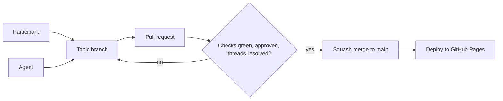

# Protecting the mainline

`main` is not just a branch here. Every push to it **publishes the site**, and
the site is what humans read and what agents load as context through
`llms.txt` and the agent API. Whatever lands on `main` becomes the shared truth
within minutes.

That is fine with three careful maintainers. It is not fine with a room full of
participants and their agents, all contributing at once. Branch protection
turns the project's social rules ("get a review", "keep the build green",
"agents draft, humans decide") into rules the platform enforces, for everyone,
every time.

## Why a crowd needs it

In a small team, trust is personal: you know who pushed what and you can ask
them. In a crowd, most contributors are strangers to each other, many
contribute once, and nobody can watch every commit. The failure modes are
predictable:

- **Unreviewed content goes live.** A direct push skips review and lands on the
  public site straight away, typos, personal data and all.
- **History gets rewritten.** A force push to `main` silently drops other
  people's merged work.
- **Two green changes make a red mainline.** Each pull request passes on its
  own, but together they break the build or a link.
- **Stale reviews.** Someone approves a pull request, then more commits arrive
  that nobody looked at.
- **Open questions get merged over.** A reviewer raises a concern and the
  change merges before it is answered.

## Why an agent swarm needs it even more

Agents change the economics of contribution. Writing a pull request is nearly
free for them, so volume goes up and the cost moves from writing to reviewing.
They also bring failure modes of their own:

- **Machine speed.** An agent can push dozens of commits while a human reads
  one diff. Without a gate, the mainline moves faster than anyone can check it.
- **Confident errors.** An agent that misreads its context produces fluent,
  plausible, wrong content. It does not hesitate, and it does not ask.
- **A feedback loop.** This site *is* agent context. An error that reaches
  `main` is published, then read back by the next agent as fact, which builds
  on it. Protection breaks the loop at the only point where every change passes
  through.
- **Self-approval.** GitHub never lets a pull request's author approve it.
  But an agent working on your token can push commits onto *someone else's*
  pull request, which you could then approve. Requiring approval of the
  *latest* push from someone who did not push it closes that gap.
- **Prompt injection by pull request.** Text in a contributed page or issue can
  try to steer an agent that later reads it. Review is the first line of
  defence for content that reaches `main`. Agents should still treat open pull
  requests and issues as untrusted input.

The principle from the [project charter](https://github.com/sddevelopment-be/socratesbe_26_secondbrain/blob/main/.kittify/charter/charter.md)
is **agents draft, humans decide**. Branch protection is how that principle
holds when no one is watching.

## The path to main



Nobody, human or agent, pushes to `main` directly. Every change takes the same
road, so every change gets the same checks.

## The rules to set on main

Use a **repository ruleset** (Settings → Rules → Rulesets) targeting the
default branch. Rulesets are free for public repositories, apply to
administrators unless they are on the bypass list, and can be exported and
imported as JSON.

| Rule | Setting | Why |
|---|---|---|
| Restrict deletions | on | `main` cannot be deleted by accident or by a confused agent. |
| Block force pushes | on | Merged history is never rewritten. |
| Require a pull request before merging | on | No direct pushes: every change is visible and reviewable. |
| Required approvals | 1 | One other participant reads every change before it goes live. |
| Dismiss stale approvals when new commits are pushed | on | An approval covers exactly what was reviewed, not later commits. |
| Require approval of the most recent reviewable push | on | Whoever pushed last cannot approve, so an agent pushing on your token cannot get its commits approved by you. Authors can never approve their own pull request anyway. |
| Require conversation resolution before merging | on | Open review questions block the merge until they are answered. |
| Allowed merge methods | squash only | One commit per pull request: a readable mainline and a clean unit to revert. |
| Require linear history | on | Keeps history straight and easy to bisect, and works with squash merges. |
| Require status checks to pass | `Syntax checks and build` | Frontmatter, Markdown syntax, links, types and the build must be green. |
| Require branches to be up to date before merging | on | Catches "two green changes make a red mainline". See [when volume grows](#when-volume-grows). |
| Bypass list | Repository admin, **for pull requests only** | See [a small team of maintainers](#a-small-team-of-maintainers). |

Leave **`Spelling (UK English, advisory)`** out of the required checks. It is
deliberately advisory: a typo should never block a contribution.

Apply the ruleset only once the docsite workflow is on `main`. The UI lists
the `Syntax checks and build` check only after it has run, but the JSON and
the API accept any name. A required check that never reports leaves every open
pull request waiting forever.

## Repository settings to go with it

The ruleset protects `main`. These settings close the remaining gaps:

| Setting | Where | Value | Why |
|---|---|---|---|
| Allow squash merging | General → Pull Requests | only squash (turn off merge commits and rebase) | Matches the ruleset, so the merge button offers one choice. |
| Automatically delete head branches | General → Pull Requests | on | Merged branches do not pile up. |
| Approval for outside collaborators' workflows | Actions → General | require approval for first-time contributors | A stranger's first pull request cannot run workflows until a maintainer has looked at it. |
| Workflow permissions | Actions → General | read repository contents | Workflows get the least privilege by default. The deploy job asks for `pages: write` itself. |
| Allow Actions to create and approve pull requests | Actions → General | off | A bot cannot approve its own pull request. |
| `github-pages` environment | Environments | deployment branches: `main` only | Only the protected branch can publish the site. |

## Apply it

Save this as `main-ruleset.json`:

```json
{
  "name": "Protect main",
  "target": "branch",
  "enforcement": "active",
  "conditions": {
    "ref_name": { "include": ["~DEFAULT_BRANCH"], "exclude": [] }
  },
  "bypass_actors": [
    { "actor_id": 5, "actor_type": "RepositoryRole", "bypass_mode": "pull_request" }
  ],
  "rules": [
    { "type": "deletion" },
    { "type": "non_fast_forward" },
    { "type": "required_linear_history" },
    {
      "type": "pull_request",
      "parameters": {
        "required_approving_review_count": 1,
        "dismiss_stale_reviews_on_push": true,
        "require_code_owner_review": false,
        "require_last_push_approval": true,
        "required_review_thread_resolution": true,
        "allowed_merge_methods": ["squash"]
      }
    },
    {
      "type": "required_status_checks",
      "parameters": {
        "strict_required_status_checks_policy": true,
        "required_status_checks": [
          { "context": "Syntax checks and build", "integration_id": 15368 }
        ]
      }
    }
  ]
}
```

`actor_id: 5` is the built-in *Admin* repository role. `integration_id: 15368`
is the GitHub Actions app: only a check reported by Actions satisfies the rule,
not a commit status that anyone with write access could post under the same
name.

**Update the existing ruleset rather than adding a second one.** Rulesets
stack: GitHub applies every active ruleset and the strictest rule wins, so a
second ruleset works but hides the real policy across two places. This
repository already has a ruleset named `TRUNK` on the default branch. Replace
its contents with the JSON above (keeping its name, if you prefer):

```sh
REPO=repos/sddevelopment-be/socratesbe_26_secondbrain
ID=$(gh api $REPO/rulesets --jq '.[] | select(.name == "TRUNK") | .id')
gh api --method PUT $REPO/rulesets/$ID --input main-ruleset.json
```

With no existing ruleset, create it instead with
`gh api --method POST $REPO/rulesets --input main-ruleset.json`, or import the
file in the UI (Settings → Rules → Rulesets → New ruleset → Import a ruleset).

## A small team of maintainers

GitHub never lets authors approve their own pull request. With one required
approval, that means a lone maintainer cannot merge their own work without a
second person.

The ruleset above handles this with a narrow bypass. Repository admins can
merge a pull request without meeting the rules, but **only through a pull
request**: they still cannot push to `main` directly, and each bypass is
recorded in the ruleset's rule insights. The bypass skips *every* rule on that
pull request, not just the approval: red checks, unresolved threads and an
out-of-date branch too. So use it only when the checks are green, for the
occasional solo fix, not as the normal path.

Once there are two or more active maintainers, remove the bypass entry and let
every change wait for a second pair of eyes.

## What this means for agents

- Agents work on a topic branch and open a pull request, and never push to
  `main`. The ruleset enforces this whatever the agent is told.
- An agent's token should not be an admin token. A fine-grained token with
  contents and pull-request write access on this repository is enough, and it
  is not on the bypass list.
- The human who asked the agent for the change should not approve it alone.
  The "most recent push" rule only helps when the agent pushes on that human's
  token. When the agent pushes from its own bot account, the requester can
  still approve, so agree as a team that someone else reviews agent work.
- Agents should read review comments as part of their loop. Unresolved threads
  block the merge, so answering them is part of finishing the job.

## When volume grows

"Require branches to be up to date" is the simple way to stop two green pull
requests from breaking `main` together. With a burst of contributions, say
during the unconference itself, it causes rebase churn: every merge makes the
other pull requests out of date.

When that hurts, switch to a **merge queue**:

1. Add `merge_group:` to the `on:` triggers in `.github/workflows/docsite.yml`,
   so the checks run on the queue's temporary branches.
2. Turn on "Require merge queue" in the ruleset, set the queue's merge method
   to **squash** (linear history requires it), and turn off "Require branches
   to be up to date". The queue has its own settings for grouping and group
   size; the defaults are fine to start with.

The queue tests each change on top of everything queued before it and merges
in order, so contributors stop chasing `main`.

Further hardening to consider later:

- **A `CODEOWNERS` file** with "Require review from code owners", so changes to
  `.github/`, `src/` or `.kittify/` need a maintainer, while `docs/` stays
  open to everyone.
- **Signed commits**, once the contributors are a stable group. At an
  unconference, the friction outweighs the benefit.
