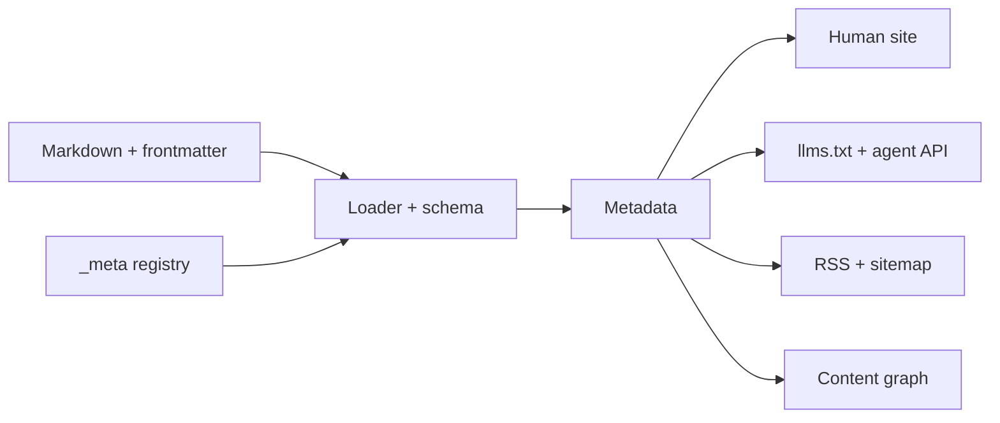
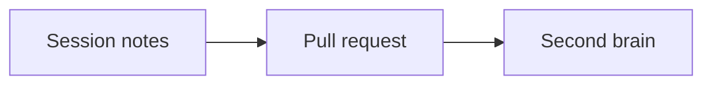
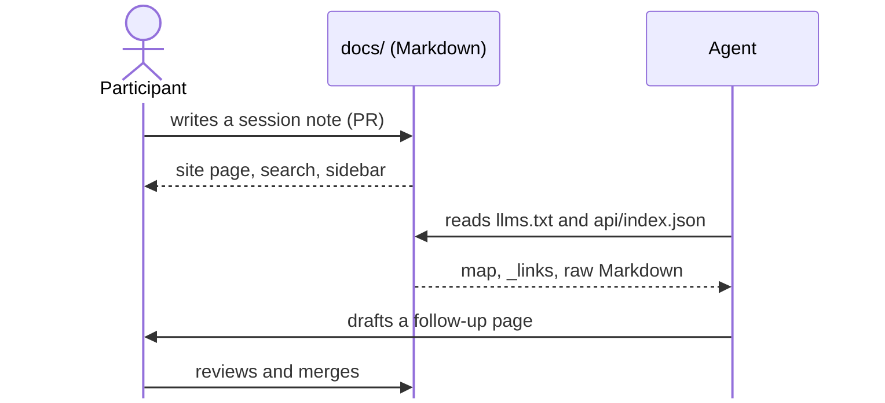

One Markdown tree. Two kinds of reader. SoCraTes BE 2026.

## You have two new colleagues

<!-- .slide: class="sb-section" data-background-gradient="linear-gradient(135deg, #9001a5 0%, #10171a 100%)" -->

One joined the team this morning. The other is an LLM.

**Both start with zero context.**

Note: Open with the room. Ask who onboarded a new colleague this year, and who asked an LLM about their own codebase this week. Same problem, two readers: neither knows why things are the way they are. This talk is about writing things down once so that both can find out.

### The map for today

| Section | Question | Skippable? |
|---|---|---|
| Why docs matter | Is this worth the effort? | yes |
| How DocKitty works | What does the tool do? | no |
| Diagrams as code | How do pictures fit in? | yes |
| Humans and LLMs | How does this help both? | no |
| Try it | Can I see it? | yes |

**→** skips a section · **↓** goes deeper

Note: The deck is sectioned on purpose. Right arrow jumps to the next section; down arrow walks through the slides of the current one. If time is short, skip "Why docs matter", "Diagrams as code" or the demo; the story still holds.

## Why docs matter

<!-- .slide: class="sb-section" data-background-gradient="linear-gradient(135deg, #9001a5 0%, #10171a 100%)" -->

Evidence first, tooling later.

Note: Optional section, about five minutes. Skip with the right arrow if the room is already convinced.

### Documentation amplifies everything else

> "High-quality documentation drastically increases the effectiveness of technical capabilities on organizational performance."
>
> *DORA, Accelerate State of DevOps Report 2023*

Trunk-based development, CI, testing: they all pay off more when the team can find out how things work.

Note: DORA has measured internal documentation quality since 2021. The 2023 report has a chapter titled "Documentation is foundational". The finding is not that docs replace practices; it is that docs multiply the payoff of the practices you already have. DORA's 2023 summary also reports about 25% higher team performance with quality documentation; quote that number with the source if asked.

### Half an hour a day, every day

**61%**

of professional developers spend more than 30 minutes a day searching for answers or solutions.

*Stack Overflow Developer Survey 2024, n ≈ 65,000*

Note: Thirty minutes a day is more than two working weeks a year, per person. Much of it is searching for things someone already knew. Documentation is how that knowledge stops living in one head.

### Blindly accept, or blindly change

> A newcomer who finds a decision without its rationale has two choices: blindly accept it, or blindly change it.
>
> *Michael Nygard, Documenting Architecture Decisions, 2011*

Both are expensive. One freezes the codebase; the other breaks it.

Note: This is the paper that introduced architecture decision records. Paraphrased on the slide, but the two options are his exact words. LLMs are the ultimate newcomer: they will happily do either, confidently. Recording the why is what lets both humans and agents change things safely.

### Docs rot because of their shape

- The structure is **too rigid to grow**, so new knowledge has nowhere to go.
- The content is **too hard to browse**, so nobody finds what exists.

*"Both failures are about shape, not writing quality."*, DocKitty problem statement

Note: Most teams do not lack writers; they lack a place where writing stays findable. That is the problem DocKitty attacks: give docs a predictable shape, then generate everything else from it.

## How DocKitty works

<!-- .slide: class="sb-section" data-background-gradient="linear-gradient(135deg, #9001a5 0%, #10171a 100%)" -->

A convention, a toolkit, and a lot of generated output.

Note: Core section, do not skip. About seven minutes.

### A convention, in one breath

```text
docs/
├── README.md            ← the home page, with frontmatter
├── context/README.md    ← each section's index is its README
├── architecture/        plans/   adr/   guides/   …
└── _meta/               ← sections, charter, citations
```

- **Common Docs** sections: context, architecture, ADRs, plans, guides, …
- `README.md` is the section index: it renders on GitHub *and* on the site.
- Every page carries frontmatter: `title`, `description`, `doc_status`, `type`, `kind`, `updated`.

Note: The convention comes from Common Docs by Christopher Skene; DocKitty adds two twists, README as the index and first-class metadata. The rule of thumb from the convention: plans describe the future, ADRs record the past, architecture describes the present.

### One source, many surfaces



Note: Walk the arrows left to right. The important part is the fan-out on the right: navigation, the agent API and the feeds are all computed from the same frontmatter. Nobody maintains a separate agent copy, so it cannot drift from what humans read. Built on Astro and Starlight.

### Metadata does double duty

```yaml
title: Add a session note
description: Create a page for a session in five minutes.
doc_status: active      # drafts never reach llms.txt or the API
type: Guide             # derived from the section
kind: How-To            # Diátaxis-style quadrant
related: [sessions]     # a broken link fails the build
```

| Field | Humans see | Agents get |
|---|---|---|
| `title`, `description` | sidebar, search | `llms.txt`, index |
| `doc_status` | draft banner | excluded until ready |
| `related` | related-pages block | `_links.related` |

Note: This is the trick. The metadata that makes docs browsable for people is most of what an agent needs. So every field has to earn its keep twice, and the build validates it.

### Guardrails, not good intentions

- **Validated frontmatter**: unknown types warn, invalid ones fail.
- **Strict link checks**, before and after the build.
- **A documentation charter** (`docs/_meta/charter.yaml`): your vocabulary, sections and statuses.
- **Accessibility lane** in CI, light and dark.
- **Dogfooded**: DocKitty documents itself in its own convention, with 64 ADRs.

Note: Docs-as-code means the same review and CI as code. In this very repository a pull request runs pnpm validate, pnpm links and pnpm build. The charter lets a team adapt the convention without forking the tool.

## Diagrams as code

<!-- .slide: class="sb-section" data-background-gradient="linear-gradient(135deg, #9001a5 0%, #10171a 100%)" -->

A picture is worth a thousand tokens, if it is also text.

Note: Optional section, about three minutes.

### Text in, figure out

````markdown

````


Note: The source is a Mermaid fence with two optional comment lines. DocKitty turns title and description into the figure caption and the accessible name of the SVG. It is themed from the same tokens as the site, so it follows light and dark mode. People learn better from words and pictures than from words alone; that is Mayer's multimedia principle.

### One diagram, three readers

- **Sighted readers** get a themed SVG with an expand button.
- **Screen-reader users** get the `title` and `description` as accessible text.
- **Agents** get the Mermaid source in the page JSON, which is text they can reason about.

Note: This is the point of diagrams as code in a two-audience docsite. A PNG on a wiki is opaque to an LLM. A Mermaid fence is a graph it can read, diff and even update in a pull request. Rendered at build time when a browser is available, otherwise in the client, with no CDN.

## Humans and LLMs, together

<!-- .slide: class="sb-section" data-background-gradient="linear-gradient(135deg, #9001a5 0%, #10171a 100%)" -->

Understanding the context, and each other.

Note: Core section, about eight minutes. This is the heart of the talk.

### A map, not a search index

| Surface | What it is |
|---|---|
| `llms.txt` | Every published page, grouped by section, one line each |
| `api/index.json` | Every page's metadata and `_links` |
| `api/pages/<slug>.json` | One page: metadata, `_links`, raw Markdown |
| `api/content-graph.json` | Pages, personas, citations and their relations |

*"An agent can follow links instead of building URLs. There is no embedding server to run and no chunking to tune."*

Note: DocKitty deliberately does not ship a RAG index. It gives agents a small, structured map and lets them fetch exactly the pages they need, following links the way a browser user would. llms.txt is Jeremy Howard's 2024 proposal for an LLM-friendly site index.

### Context quality beats context quantity

> Performance "significantly degrades when models must access relevant information in the middle of long contexts."
>
> *Liu et al., Lost in the Middle, 2023*

> Good context engineering means "finding the smallest possible set of high-signal tokens".
>
> *Anthropic, Effective context engineering for AI agents, 2025*

Note: Dumping a whole wiki into a prompt is not documentation for agents. Models degrade with long, noisy context. What helps is a small, accurate, well-labelled set of pages, which is exactly what good human documentation already is.

### Curation beats volume

| Study | Finding |
|---|---|
| Vercel, 2026 | A compact docs index in `AGENTS.md`: **100%** on their evals vs **53%** without |
| ETH Zurich, 2026 | Generic context files do **not** generally improve task success, and cost 20% more |

**Specific, current, curated docs help. Generic overviews do not.**

Note: These two results look contradictory and are not. Vercel's file was a curated, specific docs index for one framework; ETH measured generic repository overviews across many projects. One vendor, one paper: treat them as signals. The common lesson is the DocKitty argument: write the specific thing once, keep it current, and let both audiences read it.

### A shared language

- **Glossary** (Contextive): one file feeds IDE hover *and* the docsite, per bounded context.
- **Gherkin scenarios** as living specifications, with test results overlaid.
- **ADRs**: the why, immutable, superseded but never edited.
- **Personas**: who a page is for, human or agent, as structured data.

*"A change in the language is a change to the model."*, Eric Evans

Note: Ubiquitous language from domain-driven design, living documentation in Martraire's sense. When the glossary, the specs and the decisions are first-class pages, a human and an agent use the same words for the same things. That is what lets them check each other's work.

### Two readers, one source: agents draft, humans decide



Note: This is the loop this very site runs on. The participant and the agent never read different documentation; they meet in a pull request. The agent brings speed, the human brings truth. The project charter makes that rule explicit.

## Try it

<!-- .slide: class="sb-section" data-background-gradient="linear-gradient(135deg, #9001a5 0%, #10171a 100%)" -->

This deck is a page in the second brain. So is everything else.

Note: Optional section. If the network is down, skip the demo and go straight to "Your turn".

### Live: ask the site what it knows

```sh
SITE=https://sddevelopment-be.github.io/socratesbe_26_secondbrain

curl -s $SITE/llms.txt | head -20

curl -s $SITE/api/index.json \
  | jq '.pages[] | {title, kind, doc_status}'

curl -s $SITE/api/pages/presentations/doc-kitty.json | jq '.title'
```

Note: Fallback if the site is not deployed yet: run pnpm dev and use SITE=http://localhost:4321/socratesbe_26_secondbrain. Show that this deck itself is in llms.txt and the agent API, so an agent can read these slides and these speaker notes as text. If there is no network at all, show the llms.txt file from a local pnpm build in dist/.

### Your turn

- **Add your session notes**: `docs/sessions/<slug>.md`, one pull request.
- **Point your agent at it**: `llms.txt`, then `AGENTS.md` to contribute.
- **Try DocKitty on your own docs**: `github.com/spec-kitty/doc-kitty`

Note: Close the loop with the room: this second brain only works if people write in it. Ask for one session note per person before Sunday.

## The map is not the territory

<!-- .slide: class="sb-section" data-background-gradient="linear-gradient(135deg, #9001a5 0%, #10171a 100%)" -->

> "A map is not the territory it represents, but, if correct, it has a similar structure to the territory, which accounts for its usefulness."
>
> *Alfred Korzybski, Science and Sanity, 1933*

Docs are the map. Keep them correct, and both kinds of reader can find their way.

Note: End here. The point is not that documentation is the system; it never is. The point is that a correct map, with a predictable structure, is useful to everyone who has to navigate, whether they think in neurons or in tokens.

### Sources

- DORA, *Accelerate State of DevOps Report*, 2023
- Stack Overflow, *Developer Survey*, 2024
- M. Nygard, *Documenting Architecture Decisions*, 2011
- C. Skene, *Common Docs*; D. Procida, *Diátaxis*
- R. Mayer, *Multimedia Learning*, 2009
- N. Liu et al., *Lost in the Middle*, 2023
- Anthropic, *Effective context engineering for AI agents*, 2025
- Vercel, *AGENTS.md outperforms skills*, 2026; Gloaguen et al., *Evaluating AGENTS.md*, 2026
- E. Evans, *Domain-Driven Design*, 2003; C. Martraire, *Living Documentation*, 2019
- J. Howard, *llms.txt*, 2024; A. Korzybski, *Science and Sanity*, 1933

Note: Every source is also in the site's bibliography and in this page's metadata, so an agent reading the deck gets the citations as structured data.
