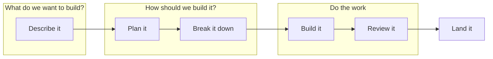
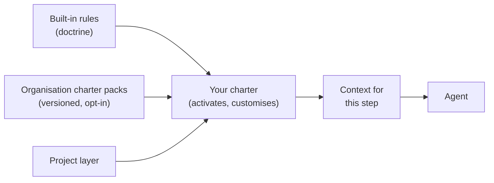
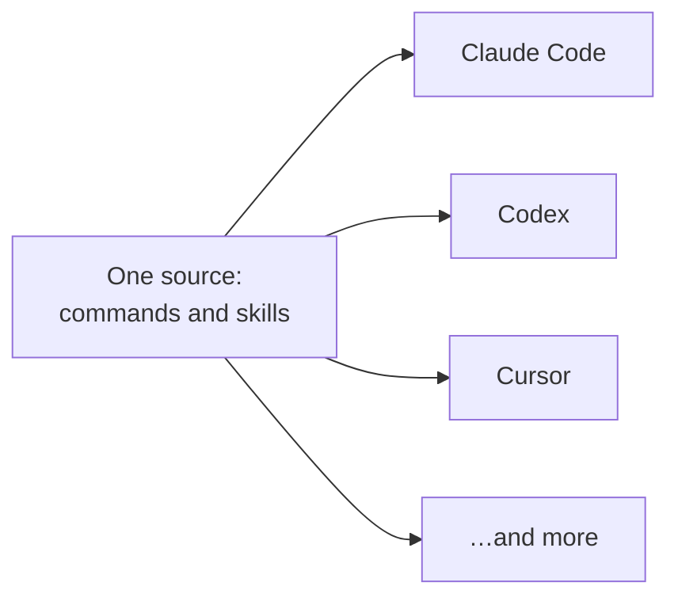

Your first Spec Kitty mission. From the two questions behind every change to a consolidated mission, in a 15-minute talk.

Note: 0:15. Introduce yourself and the one idea: agents write the code, people decide what gets built and what gets merged. The talk goes from the big picture down to the commands, so everyone can stop at the level of detail they need.

## Two questions before any code

<!-- .slide: class="sb-section" data-background-gradient="linear-gradient(135deg, #9001a5 0%, #10171a 100%)" -->

What do we want to build? How should we build it?

Note: 0:10. Core section, the map for the rest of the talk.

### The whole flow on one slide



**What and why first. Then how. Only then code.**

Note: 1:00. Every later slide hangs off one of these boxes. The Spec Kitty docs put it plainly: the specification answers what are we building and why; the plan answers how will we build it. Most agent sessions start in the "do the work" box and try to answer the first two questions on the fly, in a chat window.

## What makes a good prompt

<!-- .slide: class="sb-section" data-background-gradient="linear-gradient(135deg, #9001a5 0%, #10171a 100%)" -->

The agent only knows what you tell it.

Note: 0:10. Core section. Everyone thinks they write good prompts; this is the checklist we will turn into files.

### A good prompt…

- says **what and why**, not only how
- states **the rules**
- says **when it is done**
- gives **just enough context**
- sits at **the right altitude**

Source: Anthropic, *Effective context engineering for AI agents*, 2025.

Note: 1:15. The last two are Anthropic's advice for agents: good context engineering means finding the smallest possible set of high-signal tokens, and the right altitude sits between brittle hardcoded logic and vague guidance that falsely assumes shared context. Context is a finite resource: long, noisy context degrades what the model recalls. The first three are what any good ticket already has. The problem is not bad prompts; it is that a prompt is typed once, into a chat, and then scrolls away.

### From prompt to files

| A prompt | Written down once |
|---|---|
| Typed into a chat, then scrolls away | A spec and a plan, in Git |
| Rules repeated every session | Project rules, fed to every step: the charter, coming up |
| "Done" is whatever the agent says | A requirements checklist, and a reviewer who is not the author |

Note: 0:45. The Spec Kitty docs: it gives your agent a clear spec, a plan, and a checklist to work from, instead of a loose prompt and a hope. Every line of a good prompt becomes a file you can review.

## How Spec Kitty helps

<!-- .slide: class="sb-section" data-background-gradient="linear-gradient(135deg, #9001a5 0%, #10171a 100%)" -->

A mission is one tracked piece of work, from idea to landed change.

Note: 0:10. So how does a prompt become files? That is what a mission is.

### The software-dev mission type

```mermaid
%% title: The software-dev mission type
%% description: You answer the specify interview; you confirm the plan; tasks splits the work into work packages; analyse checks spec, plan and tasks for gaps; agents implement each work package; a reviewer who is not the author approves it or sends it back; you accept the mission and consolidate it onto your branch.
flowchart LR
  S["specify<br/>(you answer)"] --> P["plan<br/>(you confirm)"] --> T[tasks]
  T --> AN[analyse]
  AN --> I[implement]
  I --> R["review<br/>(not the author)"]
  R -- changes needed --> I
  R -- approved --> A["accept<br/>(you decide)"] --> C[consolidate]
```



**Tasks** splits the work into **work packages**: bounded slices of the mission. You decide at three steps.

Note: 1:15. These are Spec Kitty's names for the boxes on the first slide: specify is "describe it", plan and tasks are "plan it, break it down", implement and review are "do the work", accept and consolidate are "land it". Software-dev is the default mission type. In specify the agent interviews you; in plan it asks its planning questions and waits for you to confirm. Reading the spec is the cheapest review you will ever do, because no code exists yet.

### What each step leaves behind

| Step | You get |
|---|---|
| specify | `spec.md` and a requirements checklist |
| plan | `plan.md`, plus research, data model and contracts where needed |
| tasks | `tasks.md` and one file per work package |
| analyse | a report: do spec, plan and tasks agree? |

All of it in the repository, committed.

Note: 0:45. Everything lands under kitty-specs, one folder per mission, as plain Markdown: it diffs, it can be reviewed, and it survives the chat window. Each specify run creates a new mission, so run it once and keep talking to it. The commands are on the "How to start" slides and on the session page.

### Review, accept, consolidate

- **Review**: a reviewer who is not the author approves each work package, or sends it back.
- **Accept**: a readiness check for the whole mission.
- **Consolidate**: lands the work on your branch and cleans up.

> "Review becomes a rubber stamp at machine speed."

Note: 0:45. The quote is the problem Spec Kitty's site names, when the agent that wrote the change is the one that says it is fine. The answer: the reviewer must differ from the implementer. Older docs say merge; in the 4.0 release candidates the step is called consolidate. It lands locally; publishing to your remote is a separate push.

### Work packages run in parallel

- Each work package has its own prompt and dependencies.
- Independent groups of work packages each get their own **Git worktree**: a second checkout, so agents never edit the same files.
- The runtime tells each agent the one next thing to do.
- A board shows the status: planned → in progress → for review → approved → done (simplified).

Note: 0:45. Optional slide, the last in this section: press → to skip it. A status lane is a column on the board; an execution lane is a group of work packages sharing one worktree. The runtime command is spec-kitty next, and the board is /spec-kitty.status. Daily agent users: this is what lets you run two or three agents at once without stepping on each other's files.

## The charter system

<!-- .slide: class="sb-section" data-background-gradient="linear-gradient(135deg, #9001a5 0%, #10171a 100%)" -->

The rules travel with the repository, not with the prompt.

Note: 0:10. The spec says what to build; the charter says the rules every agent follows while building it. We stay at the level of ideas; the details are in the docs.

### One charter, fed to every step



> "The agent does not invent governance; it reads and complies with what the charter says."

Note: 1:00. Doctrine is the reusable rule content. It comes in three layers: built in, shared by your organisation as versioned charter packs, and your project's own, which wins. The charter decides what is active. Each step gets only the slice it needs: the "smallest set of high-signal tokens" from the good-prompt slide, applied by the tool instead of by you.

### Distributable packs, configurable missions

- **Charter packs**: an organisation ships its rules once, versioned.
- **Skill packs**: one reviewed skill, the same in every coding agent.
- **Mission types**: software-dev, research, documentation and plan built in; add your own.

Note: 0:45. The way you work becomes something you can version, share and review, instead of a prompt each developer keeps in their head. On the command line: charter fetch pulls an organisation's packs, and charter pack assemble combines packs into one distributable. Custom mission types plug in from the project, the organisation or your home folder. This very talk was produced twice: once ad hoc, and once as a documentation mission with its own steps.

### Roles, not one do-everything agent

- **Agent profiles** give each role its own job, rules and limits: researcher, architect, planner, implementer, reviewer, and more.
- **Separation is enforced**: the reviewer is never the author.
- **Focused context**: one role, one step, only the rules for that step.

Note: 0:45. Why split? An agent grading its own work is the rubber stamp from earlier. And Anthropic's guidance is that specialised sub-agents handle focused tasks best with clean context windows. A role gives a model a narrow job and the rules for that job only. Version 4.0.0rc7 ships 26 built-in profiles; spec-kitty profiles list shows them.

### One source, every coding agent



A mixed team uses different tools, and still follows the same process and rules.

Note: 0:45. The docs: all agents execute the same workflow, but their command file formats differ, so Spec Kitty keeps a single source of truth and renders Markdown, TOML or skill files per agent. The tool that runs the agent is often called a harness. Pass several at init with --ai claude,codex, add one later with spec-kitty agent config add, or build a plugin bundle with spec-kitty plugin build.

## Three ways to work

<!-- .slide: class="sb-section" data-background-gradient="linear-gradient(135deg, #9001a5 0%, #10171a 100%)" -->

From fully tracked to fully interactive: pick what fits the work.

Note: 0:10. You do not need the whole machine for every change. Three ways to use it.

### Mission, governed op, or ad hoc

| Mode | Use it when | You get |
|---|---|---|
| **Mission** | The work needs a spec, or "let's continue tomorrow" | Spec, plan, work packages, review gate |
| **Governed op**: one tracked request | One sentence, one sitting | The right role, the charter loaded, a record |
| **Ad hoc**: interactive pairing | You are exploring with your agent | The charter's rules on demand |

Note: 1:00. The rule of thumb is the docs' own: if you can describe the task in one sentence and expect it done in one sitting, it is an op; if you would naturally write a spec, or "let's continue tomorrow" makes sense, it is a mission. A governed op is spec-kitty dispatch with your request: it picks a profile, loads the charter and keeps a record until you close it. The docs call that the ad-hoc specialist session; here, ad hoc means plain pairing without an op. Even then, Spec Kitty's orientation sits in your agent's instructions, and spec-kitty charter context renders the rules for any step on demand.

## How to start

<!-- .slide: class="sb-section" data-background-gradient="linear-gradient(135deg, #9001a5 0%, #10171a 100%)" -->

Install, initialise, commit, charter, specify.

Note: 0:10. Enough concepts. Here is what you type tomorrow.

### Install and initialise

```sh
pipx install "spec-kitty-cli==4.0.0rc7"    # a release candidate needs the exact pin

# a new project
spec-kitty init my-project --ai claude && cd my-project
git init -b main && git add -A && git commit -m "init"

# or an existing repository
spec-kitty init --ai claude
git add .kittify .gitignore .gitattributes && git commit -m "Add Spec Kitty"

git checkout -b first-mission && spec-kitty verify-setup
```

**`init` never touches Git.** Without a first commit, specify fails.

Note: 1:00. You need Python 3.11 or newer, pipx, Git, and a coding agent signed in with your own model account. Why the pin: a plain pipx install gives the stable 3.2 line, where consolidate is still called merge. If you already have 3.x, add --force. In an existing repository, commit only the Spec Kitty files; init already keeps the .claude folder out of Git. Both paths were checked on 4.0.0rc7 on 24 October 2026.

### Give the repository a charter

```sh
spec-kitty charter interview --profile minimal   # the shortest interview; or /spec-kitty.charter
spec-kitty charter generate --from-interview
spec-kitty charter synthesize                    # then commit what it lists
spec-kitty charter status                        # everything fresh: you are ready
```

> **People first.** Write about ideas, not people.
>
> *This repository's charter*

Note: 0:45. Here, --profile picks the length of the interview, not an agent profile. The interview writes the answers to .kittify/charter/interview/answers.yaml; generate turns them into charter.yaml and stages charter.md; synthesize prepares the charter for the runtime. Do not skip synthesize: the mission behind this talk stopped at its first step because synthesis had not run. The example is from this site's charter: it goes on to say no participant names are added, which becomes a concrete review check.

### Your first mission, tomorrow morning

1. Install with the pin, `init`, commit, branch, `verify-setup`.
2. Write the charter: interview, generate, synthesize.
3. `/spec-kitty.specify` one real item: a ticket, a postponed refactor, or docs for a module only one person understands.

**Too small for a mission?** `spec-kitty dispatch "<request>"`.

Note: 0:45. The first-pick suggestions come from the getting-started guide. From there: /spec-kitty.plan (you confirm), /spec-kitty.tasks, then spec-kitty next until every work package is reviewed; then spec-kitty accept and spec-kitty consolidate.

### Learn more

- `spec-kitty.ai/getting-started.md`: install and first command
- `docs.spec-kitty.ai`: tutorials and the command reference
- `github.com/spec-kitty/spec-kitty`: the MIT source
- This talk's session page on the second brain: commands, links and the recap

Note: 0:10. Point people at the session page: every command in one place, the links with a line on why each matters, and an empty recap they can fill in.
