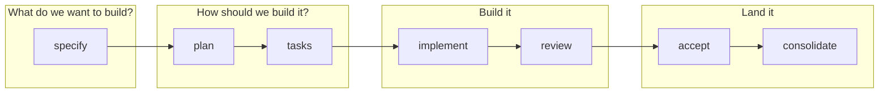
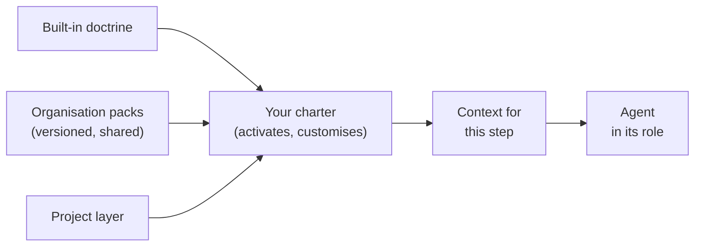
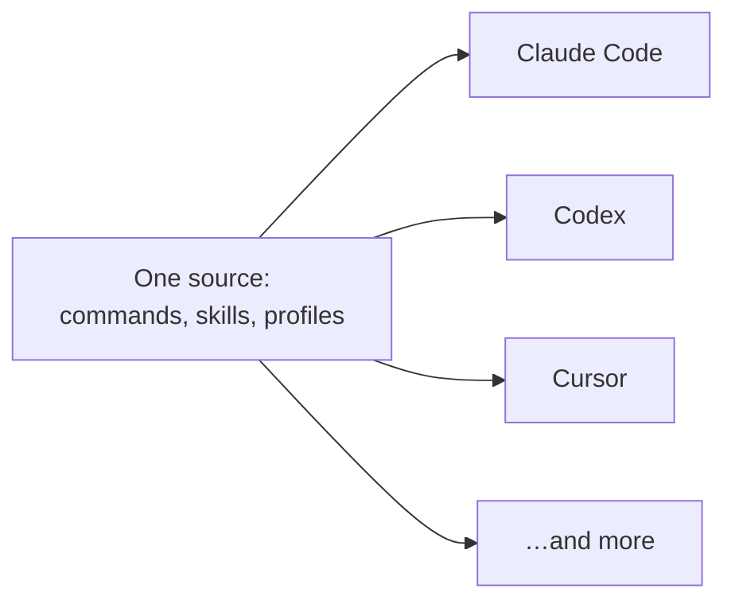

```mermaid
%% title: The software-dev mission type
%% description: You answer the specify interview; you confirm the plan; tasks splits the work into work packages; analyse checks spec, plan and tasks for gaps; agents implement each work package; a reviewer who is not the author approves it or sends it back; you accept the mission and consolidate it onto your branch.
flowchart LR
  S["specify<br/>(you answer)"] --> P["plan<br/>(you confirm)"] --> T[tasks]
  T --> AN[analyse]
  AN --> I[implement]
  I --> R["review<br/>(not the author)"]
  R -- changes needed --> I
  R -- approved --> A["accept<br/>(you decide)"] --> C[consolidate]
```

Your first Spec Kitty mission. From the two questions behind every change to a consolidated mission, in a 15-minute talk.

Note: 0:15. Introduce yourself, then the pitch in the site's own words: your AI agents write the code, your people make the calls. The talk goes from the big picture down to the commands, so anyone can stop listening for detail at the level they need.

## Two questions before any code

<!-- .slide: class="sb-section" data-background-gradient="linear-gradient(135deg, #9001a5 0%, #10171a 100%)" -->

What do we want to build? How should we build it?

Note: 0:10. Core section, the map for the rest of the talk.

### The whole flow on one slide



**Answer what and why first. Then how. Only then code.**

Note: 1:15. This is the spine of the whole talk; every later slide hangs off one of these four boxes. The docs put it plainly: the specification answers what are we building and why; the plan answers how will we build it. Most agent sessions start in the "build it" box and try to answer the first two questions on the fly, in a chat window.

## What makes a good prompt

<!-- .slide: class="sb-section" data-background-gradient="linear-gradient(135deg, #9001a5 0%, #10171a 100%)" -->

The agent only knows what you tell it.

Note: 0:10. Optional for a room that already writes careful prompts: press → to skip to how Spec Kitty helps.

### A good prompt…

- **says what and why**, not only how;
- **states the rules**: constraints, conventions, what must not break;
- **says how you will know it is done**;
- **gives the context it needs, and no more**: "the smallest possible set of high-signal tokens";
- **sits at the right altitude**: not brittle step-by-step logic, not vague guidance that assumes shared context.

Source: Anthropic, *Effective context engineering for AI agents*, 2025.

Note: 1:15. The last two points are Anthropic's own advice for agents: context is a finite resource, and long, noisy context degrades what the model recalls. The first three are what any good ticket already has. The problem is not that developers write bad prompts; it is that a prompt is typed once, into a chat, and then scrolls away.

### From prompt to spec

| A prompt | A Spec Kitty mission |
|---|---|
| Typed into a chat, then scrolls away | `spec.md` and `plan.md` in Git |
| Rules repeated every session | A charter, fed to every governed step |
| "Done" is whatever the agent says | Acceptance criteria and a reviewer who is not the author |

> "It gives your agent a clear spec, a plan, and a checklist to work from — instead of a loose prompt and a hope."

Note: 0:45. The quote is from the Spec Kitty docs. Every property of a good prompt becomes a file you can review: the what and why live in the spec, the rules in the charter, done in the acceptance criteria.

## How Spec Kitty helps

<!-- .slide: class="sb-section" data-background-gradient="linear-gradient(135deg, #9001a5 0%, #10171a 100%)" -->

A mission is one tracked piece of work, from idea to landed change.

Note: 0:10. Core section.

### The software-dev mission



You decide at three steps: specify, plan, accept.

Note: 1:15. This is the software-dev mission type, the default; its core steps are specify, plan, tasks, implement and review, with analyse, accept and consolidate around them. In specify the agent interviews you; in plan it asks its planning questions and waits for you to confirm. Reading the spec is the cheapest review you will ever do, because no code exists yet.

### What each step leaves behind

| Step | Command | You get |
|---|---|---|
| specify | `/spec-kitty.specify` | `spec.md` and a requirements checklist |
| plan | `/spec-kitty.plan` | `plan.md`, plus research, data model, contracts |
| tasks | `/spec-kitty.tasks` | `tasks.md` and one `tasks/WP01…` file per work package |
| analyse | `/spec-kitty.analyze` | `analysis-report.md`: do spec, plan and tasks agree? |

All of it under `kitty-specs/<mission>/`, committed.

Note: 0:45. Each specify run creates a new mission, so run it once and keep talking to it. Everything is plain Markdown in the repository: it diffs, reviews, and survives the chat window.

### Review, accept, consolidate

- **Review**: a reviewer who did not write the package approves it, or sends it back.
- **Accept**: `spec-kitty accept` checks the mission is ready.
- **Consolidate**: `spec-kitty consolidate` lands the work on your branch and cleans up.

> "The agent that wrote the change is the one that says it's fine. Review becomes a rubber stamp at machine speed."

Note: 0:45. The quote is the problem Spec Kitty's site names; the answer is that a reviewer must differ from the implementer, and a generic identity never counts as one. Older docs say merge; in the 4.0 release candidates the command is consolidate. Consolidate lands locally; opening the pull request is still your move.

### Work packages run in parallel

- A **work package** is one bounded slice: its own prompt, dependencies and files.
- Independent packages get their **own Git worktree**: a second checkout, so agents do not collide.
- `spec-kitty next` tells an agent the one next thing to do.
- `/spec-kitty.status` shows the board: planned → in progress → for review → approved → done.

Note: 0:45. Optional slide, the last in this section: press → to skip it. A status lane is a column on the board; an execution lane is a group of packages sharing one worktree. Daily agent users: this is what lets you run two or three agents at once without a merge fight.

## The charter system

<!-- .slide: class="sb-section" data-background-gradient="linear-gradient(135deg, #9001a5 0%, #10171a 100%)" -->

The rules travel with the repository, not with the prompt.

Note: 0:10. Core section. We stay at the level of ideas; the artefact types are in the docs.

### One rulebook, fed to every step



> "The agent does not invent governance; it reads and complies with what the charter says."

Note: 1:00. Doctrine is the governed content: directives, tactics, style guides and the like. It comes in three layers: built in, shared by your organisation as versioned packs, and your project's own. The charter decides what is active. Each step gets only the slice it needs, which is the "smallest set of high-signal tokens" idea applied by the tool instead of by you.

### Distributable packs, configurable missions

- **Charter packs**: an organisation ships its rules once, versioned (`charter fetch`, `charter pack assemble`).
- **Skill packs**: one reviewed skill definition, so every agent tool in the project gets the same skill.
- **Plugin bundles**: `spec-kitty plugin build --target claude-code` packages commands and profiles.
- **Mission types**: software-dev, research, documentation and plan ship built in; custom types plug in from project, organisation or user locations.

Note: 0:45. The point for a team: the way you work becomes something you can version, share and review, instead of a prompt each developer keeps in their head. This very talk was produced twice: once ad hoc, and once as a documentation mission with its own steps.

### Roles, not one do-everything agent

- **Agent profiles** give each role its own identity, routing and boundaries: researcher, architect, planner, implementer, reviewer, and more (26 built in).
- **Separation is enforced**: the reviewer must not be the implementer.
- **Focused context**: each role gets only the governance its step needs.

`spec-kitty profiles list`

Note: 0:45. Why split? An agent grading its own work is the rubber stamp from the earlier quote. And Anthropic's guidance is that specialised sub-agents work best with clean, focused context windows. A role is a way to give a model a narrow job and the rules for that job only.

### One source, every harness



`spec-kitty init --ai claude,codex` · `spec-kitty agent config add <agent>`

Note: 0:45. The docs: all agents execute the same workflow, but their command file formats differ, so Spec Kitty keeps a single source of truth and renders Markdown, TOML or skill files per agent. A mixed team can use different tools and still follow the same process and rules.

## Three ways to work

<!-- .slide: class="sb-section" data-background-gradient="linear-gradient(135deg, #9001a5 0%, #10171a 100%)" -->

Choose the lightest path that still fits the work.

Note: 0:10. Core section.

### Mission, governed op, or ad hoc

| Mode | Use it when | What you get |
|---|---|---|
| **Mission** | You would want a spec, or "let's continue tomorrow" makes sense | Spec, plan, work packages, review gate |
| **Governed op**: `spec-kitty dispatch "<request>"` | One sentence, one sitting | The right profile, the charter loaded, a record of what was done |
| **Ad hoc** | Interactive pairing with your agent | Charter guidance in the agent's instructions; `spec-kitty charter context --action <step>` on demand |

Note: 1:00. The rule of thumb is the docs' own: if you can describe the task in one sentence and expect it done in one sitting, it is an op; if you would naturally write a spec, or "let's continue tomorrow" makes sense, it is a mission. Ad hoc is not ungoverned: init writes an orientation block into your agent's instructions, and charter context renders the rules for any step.

## How to start

<!-- .slide: class="sb-section" data-background-gradient="linear-gradient(135deg, #9001a5 0%, #10171a 100%)" -->

Install, initialise, commit, charter, specify.

Note: 0:10. Core section: the commands.

### Install and initialise

```sh
pipx install "spec-kitty-cli==4.0.0rc7"    # a release candidate needs the exact pin

# a new project
spec-kitty init my-project --ai claude && cd my-project
git init -b main && git add -A && git commit -m "init"

# or an existing repository
spec-kitty init --ai claude
git add .kittify .gitignore .gitattributes && git commit -m "Add Spec Kitty"

git checkout -b first-mission && spec-kitty verify-setup
```

**`init` never touches Git.** Without a first commit, specify fails.

Note: 1:00. You need Python 3.11 or newer, pipx, Git, and a coding agent signed in with your own model account. Why the pin: a plain pipx install gives the stable 3.2 line, where consolidate is still called merge. If you already have 3.x, add --force. In an existing repository, commit only the Spec Kitty files; init already keeps the agent folders out of Git. Both paths were checked on 4.0.0rc7 on 24 October 2026.

### Give the repository a charter

```sh
spec-kitty charter interview --profile minimal   # or /spec-kitty.charter in the agent
spec-kitty charter generate --from-interview
spec-kitty charter synthesize                    # then commit what it lists
spec-kitty charter status                        # everything fresh: you are ready
```

> **People first.** … Participant names are not added to the site.
>
> *This repository's charter*

Note: 0:45. The interview writes the answers to .kittify/charter/interview/answers.yaml; generate turns them into charter.yaml and stages charter.md; synthesize prepares the charter for the runtime. Do not skip synthesize: the mission behind this talk stopped at its first step because synthesis had not run. The example is from this site: one value statement that becomes a concrete review check.

### Your first mission, tomorrow morning

1. Install with the pin, `init`, commit, branch, `verify-setup`.
2. Write the charter: interview, generate, synthesize.
3. `/spec-kitty.specify` one real item: a ticket, a postponed refactor, or docs only one person can write.

**Too small for a mission?** `spec-kitty dispatch "<request>"`.

Note: 0:45. The first-pick suggestions come from the getting-started guide. From here, the agent drives: plan, tasks, then spec-kitty next until every work package is reviewed.

### Learn more

- `spec-kitty.ai/getting-started.md`: install and first command
- `docs.spec-kitty.ai`: tutorials and the command reference
- `github.com/spec-kitty/spec-kitty`: the MIT source
- This talk's session page on the second brain: commands, links and the recap

Note: 0:10. Point people at the session page: every command in one block, the links with a line on why each matters, and an empty recap they can fill in.
