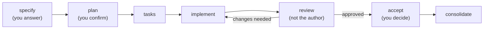

Your first Spec Kitty mission. From an empty repository to a consolidated mission, in a 15-minute talk.

Note: 0:30. Introduce yourself, then the pitch in the site's own words: your AI agents write the code, your people make the calls. The room has two halves: people who live in Claude Code or Codex, and people who have not let an agent near their code yet. Both get the same two promises: how to start tomorrow, and the whole lifecycle in one picture.

## Why specs before code

<!-- .slide: class="sb-section" data-background-gradient="linear-gradient(135deg, #9001a5 0%, #10171a 100%)" -->

A loose prompt and a hope, or a spec, a plan and a checklist.

Note: 0:15. Optional section. If the room already writes specs first, press → to skip it.

### What goes wrong without a spec

| Prompt and hope | Spec Kitty |
|---|---|
| The intent lives in a chat that scrolls away | The spec is a file in Git |
| Several agents, one branch, collisions | Each work package gets its own worktree |
| The agent marks its own homework | A separate reviewer checks against the spec |

**Specs, plans, work packages and review state live next to the code.**

Note: 1:30. The developers page puts it as: your agent asks first and writes a spec before it builds, then a separate reviewer checks the work against the spec and your rules. Two terms before we go on: a work package is one slice of the work; a worktree is a second checkout of the same repository, so two agents never edit the same files. For the sceptics in the room: nothing here asks you to trust the agent more. It asks the agent to show its work, in files you can review like any pull request.

## Start tomorrow

<!-- .slide: class="sb-section" data-background-gradient="linear-gradient(135deg, #9001a5 0%, #10171a 100%)" -->

Install, initialise, commit, charter.

Note: 0:15. Core section. Do not skip.

### Install and initialise

```sh
pipx install "spec-kitty-cli==4.0.0rc7"    # a release candidate needs the exact pin

# a new project
spec-kitty init my-project --ai claude && cd my-project
git init -b main && git add -A && git commit -m "init"

# or an existing repository
spec-kitty init --ai claude
git add .kittify .gitignore .gitattributes && git commit -m "Add Spec Kitty"

git checkout -b first-mission && spec-kitty verify-setup
```

- `init` adds `.kittify/` and your agent's commands, for example `.claude/`.
- **`init` never touches Git.** Without a first commit, specify fails.

Note: 1:30. You need Python 3.11 or newer, pipx, Git, and a coding agent signed in with your own model account. Claude Code, Codex, Cursor, Copilot, Gemini and over a dozen more are supported; pass several as --ai claude,codex. Why the pin: a plain pipx install gives the stable 3.2 line, where consolidate is still called merge; this talk uses the 4.0 release candidate. If you already have 3.x, add --force. In an existing repository, commit only the Spec Kitty files, not your work in progress; init already keeps the agent folders out of Git. Both paths, and the charter steps on the next slide, were checked on 4.0.0rc7 on 24 October 2026.

### Give the repository a charter

```sh
spec-kitty charter interview --profile minimal   # or /spec-kitty.charter in the agent
spec-kitty charter generate --from-interview
spec-kitty charter synthesize                    # then commit what it lists
spec-kitty charter status                        # everything fresh: you are ready
```

> **People first.** … Participant names are not added to the site.
>
> *This repository's charter*

**The charter is the repository's rulebook. Spec Kitty feeds the relevant rules to the agent at each governed step.**

Note: 1:30. The charter holds purpose, principles, quality gates and review policy. The interview writes the answers to .kittify/charter/interview/answers.yaml; generate turns them into charter.yaml and stages charter.md; synthesize prepares the charter for the runtime. Do not skip synthesize: a mission built for this very talk stopped at its first step because synthesis had not run. The example is from this site: one value statement that becomes a concrete review check. Upstream, a charter overhaul is being designed as a separate service with charter packs; it is an early build and not what you install today.

## The mission lifecycle

<!-- .slide: class="sb-section" data-background-gradient="linear-gradient(135deg, #9001a5 0%, #10171a 100%)" -->

A mission is one tracked piece of work, from idea to landed change.

Note: 0:15. Core section, the heart of the talk.

### From idea to landed change



Seven steps. You decide at three of them: specify, plan, accept.

Note: 1:30. Walk it left to right. In specify the agent interviews you; in plan it asks its planning questions and waits for you to confirm the plan. Reading the spec is the cheapest review you will ever do, because no code exists yet. Review is done by someone other than the implementer, and accept is yours. The loop between implement and review is where agents do the heavy lifting.

### What each step leaves behind

| Step | Command | You get |
|---|---|---|
| specify | `/spec-kitty.specify` | `spec.md` and a requirements checklist |
| plan | `/spec-kitty.plan` | `plan.md`, plus research, data model, contracts |
| tasks | `/spec-kitty.tasks` | `tasks.md` and one `tasks/WP01…` file per work package |
| analyse | `/spec-kitty.analyze` | `analysis-report.md`: do spec, plan and tasks agree? |

All of it under `kitty-specs/<mission>/`, committed.

Note: 1:30. Each specify run creates a new mission, so run it once and keep talking to it. Analyse is optional but cheap: it catches a task that no requirement asks for, or a requirement no task covers. Everything here is plain Markdown in the repository, so it diffs, reviews and survives the chat window.

### Work packages run in parallel

- A **work package** is one bounded slice: its own prompt, dependencies and files.
- Independent packages get their **own Git worktree**, so agents do not collide.
- `spec-kitty next` tells an agent the one next thing to do.
- `/spec-kitty.status` shows the board: planned → in progress → for review → approved → done.

Note: 1:30. Two meanings of "lane" trip people up: a status lane is a column on the board; an execution lane is a group of packages sharing one worktree. Daily agent users: this is what lets you run two or three agents at once without a merge fight.

### Review, accept, consolidate

- **Review**: a reviewer who did not write the package approves it, or sends it back with feedback.
- **Accept**: `spec-kitty accept` checks the mission is ready.
- **Consolidate**: `spec-kitty consolidate` lands the work on your branch and cleans up the worktrees.

**A human makes the final call.**

Note: 1:15. If you read older docs, you will see "merge": in the 4.0 release candidates the command is consolidate, and merge is gone. After it lands there is a mission review, spec against code, and a retrospective. Consolidate lands locally; opening the pull request is still your move.

## Your turn

<!-- .slide: class="sb-section" data-background-gradient="linear-gradient(135deg, #9001a5 0%, #10171a 100%)" -->

One real item from your backlog.

Note: 0:15. Closing.

### Tomorrow morning

1. Install with the `4.0.0rc7` pin, `init`, commit, branch, `verify-setup`.
2. Write the charter: interview, generate, synthesize.
3. `/spec-kitty.specify` one real item: a ticket, a postponed refactor, or docs only one person can write.

**Too small for a mission?** `spec-kitty dispatch "<request>"` runs it with the charter loaded, and keeps a record.

Note: 1:00. The first-pick suggestions come from the getting-started guide. A one-line fix does not need a spec, a plan and work packages; dispatch gives it the charter and a record without the ceremony.

### Learn more

- `spec-kitty.ai/getting-started.md`: install and first command
- `docs.spec-kitty.ai`: tutorials and the command reference
- `github.com/spec-kitty/spec-kitty`: the MIT source
- This talk's session page on the second brain: commands, links and the recap

Note: 0:30. Point people at the session page: it has every command from today in one block, the links with a line on why each matters, and an empty recap they can fill in.
