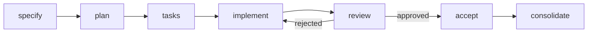

Spec Kitty in 15 minutes. Your first mission, from an empty repository to a merge.

Note: Introduce yourself and the one-line pitch: give your agent a clear spec, a plan and a checklist instead of a loose prompt and a hope. Who is in the room: developers, some living in Claude Code or Codex every day, some who have not let an agent near their code yet. Promise them two things: how to start tomorrow, and the whole lifecycle in one picture.

## Why specs before code

<!-- .slide: class="sb-section" data-background-gradient="linear-gradient(135deg, #9001a5 0%, #10171a 100%)" -->

Your agents write the code. Your people make the calls.

Note: About two minutes. Skippable with → if the room already does spec-first work.

### Three ways agent coding goes wrong

- **Lost intent.** Requirements and decisions live in a chat that scrolls away.
- **No boundaries.** Several agents, one branch, merge chaos.
- **Self-grading.** The agent that wrote the code also says it is done.

**Spec Kitty keeps intent, work and review in the repository.**

Note: These three problems are how spec-kitty.ai frames it. The answer is boring on purpose: specs, plans, work packages and review state are files in Git, next to the code. If you have been sceptical of agents, this is the part that should interest you: humans stay in charge of what and why, and of the final merge.

## Start tomorrow

<!-- .slide: class="sb-section" data-background-gradient="linear-gradient(135deg, #9001a5 0%, #10171a 100%)" -->

Five commands and a charter.

Note: Core section, about five minutes. Do not skip.

### Install and initialise

```sh
pipx install spec-kitty-cli
spec-kitty init my-project --ai claude      # or: spec-kitty init . --ai claude,codex
cd my-project

git init -b main && git add -A && git commit -m "init"
git checkout -b first-mission

spec-kitty verify-setup
```

- `init` creates `.kittify/` and the agent's commands, for example `.claude/`.
- `init` **never touches Git.** Make the first commit yourself.

Note: Prerequisites are Python 3.11 or newer, pipx, Git, and a coding agent signed in with your own model account: your models, your keys. Many agents are supported: Claude Code, Codex, Cursor, Copilot, Gemini and over a dozen more. The Git step trips everyone up: with no commit, specify fails. Running init again is safe.

### Give the repository a charter

```text
/spec-kitty.charter                          # in the agent: a short interview
spec-kitty charter interview --profile minimal
spec-kitty charter generate --from-interview
```

> **People first.** Participant names are not added to the site.
>
> *This repository's charter*

The charter is the repository's rulebook. Spec Kitty puts the relevant rules into the agent's prompt at every step.

Note: The charter covers purpose, principles, quality gates and review policy. The answers go to .kittify/charter/interview/answers.yaml and the generated, authoritative rules to charter.yaml. The example is from this very site: one value statement that becomes a concrete review check. If asked: a charter overhaul is being designed in the spec-kitty-charter repository, a separate service with charter packs for organisations. It is an early build, not shipped.

## The mission lifecycle

<!-- .slide: class="sb-section" data-background-gradient="linear-gradient(135deg, #9001a5 0%, #10171a 100%)" -->

A mission is one tracked piece of work, from idea to merge.

Note: Core section, about six minutes. This is the heart of the talk.

### Seven steps, each leaves a file



| Step | You get |
|---|---|
| `/spec-kitty.specify` | `spec.md`, a requirements checklist |
| `/spec-kitty.plan` | `plan.md`, data model, contracts |
| `/spec-kitty.tasks` | `tasks.md` and `tasks/WP01…` work packages |

Note: Everything lands in a folder per mission under kitty-specs. Specify and plan are interviews: the agent asks, you answer, you confirm. Read the spec before any code is written; that is the cheapest review you will ever do. Optional extras: `/spec-kitty.research` before the spec, `/spec-kitty.analyze` after tasks to check spec, plan and tasks against each other.

### Work packages run in parallel

- Each **work package** (WP) is a bounded slice with its own prompt, dependencies and files.
- Independent WPs get their **own Git worktree**, so agents do not collide.
- `spec-kitty next` tells the agent the one next action.

`planned → in_progress → for_review → approved → done`

Note: The status board is /spec-kitty.status. Careful with the word "lane": a status lane is a kanban column; an execution lane is a group of WPs that share one worktree. The runtime, not the agent, picks the worktree. The implement-review loop can be driven by one skill, so you do not have to babysit every WP.

### Review, accept, consolidate

- **Review**: a reviewer who did not write the code approves, or rejects with feedback.
- **Accept**: `/spec-kitty.accept` checks the mission is ready.
- **Consolidate**: `/spec-kitty.consolidate` lands the work on your branch and cleans up the worktrees.

**A human makes the final call.**

Note: Older docs and the README still say "merge"; in the 4.0 release candidates the command is consolidate. After the merge there is a mission review, spec against code, and a retrospective. For tiny one-off changes a mission is overkill: spec-kitty dispatch handles a quick request with the charter loaded and a record of what was done.

## Your turn

<!-- .slide: class="sb-section" data-background-gradient="linear-gradient(135deg, #9001a5 0%, #10171a 100%)" -->

Pick one real item from your backlog.

Note: Closing, about one minute.

### Tomorrow morning

1. `pipx install spec-kitty-cli`, then `spec-kitty init . --ai <your agent>`.
2. Commit, branch, run `/spec-kitty.charter`.
3. `/spec-kitty.specify` a real ticket, a refactor you keep postponing, or the docs for a module only one person understands.

**Learn more:** `spec-kitty.ai` · `docs.spec-kitty.ai` · `github.com/spec-kitty/spec-kitty`

Note: The first-pick suggestions come from the getting-started guide. Point people at the session page in this second brain for the links and, after the session, the recap. Ask them to add what they learned.
