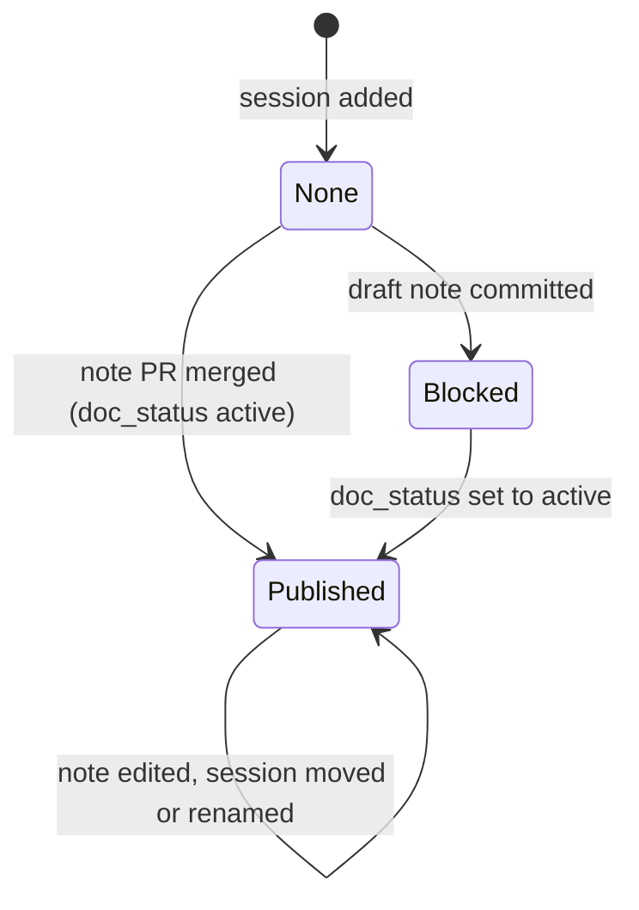

# Data Model: Living schedule and session notes

All schedule data is YAML under `docs/_meta/schedule/`. Writing rules, enforced by
the check (FR-019 c): no comments; every text value double-quoted; `uncertain` a
bare `true` or `false`; nothing that YAML 1.1 and 1.2 readers would read
differently. Objects are closed: an unknown key is an error (no person field can
be added). Lengths are counted in Unicode code points.

## Room (`rooms.yaml`)

```yaml
rooms:
  - key: "sambre-meuse"        # lowercase ASCII and hyphens; referenced by sessions
    name: "Sambre / Meuse"     # display name, as on the board
    size: "XL"                 # XL | L | S
    equipment: ["projector"]   # zero or more of: projector, screen
```

| Field | Type | Rules |
|---|---|---|
| `key` | string | `^[a-z0-9]+(-[a-z0-9]+)*$`, unique |
| `name` | string | non-empty |
| `size` | enum | `XL`, `L`, `S` |
| `equipment` | list of enum | `projector`, `screen`; may be empty |

The list order is the board's left-to-right order and the table's column order.

## Day (`<YYYY-MM-DD>.yaml`)

```yaml
date: "2026-10-23"             # must equal the file name
snapshot: "2026-10-23T21:47"   # board snapshot, local time Europe/Brussels
slots:
  - key: "1050"                # unique within the day
    start: "10:50"             # HH:MM, 24-hour
    type: "session"            # session | lunch | closing | dinner
sessions:
  - id: "2026-10-23-event-storming"
    title: "Event Storming"
    description: "Chaos management — what are we even building?"   # optional, ≤ 140 chars
    room: "ourthe"             # exactly one of room | place
    slot: "1330"               # exactly one of slot | section
  - id: "2026-10-23-run-session"
    title: "Run Session"
    place: "Outside"           # short display label (free text, proofread)
    section: "outside"         # lunch-tables | outside | evening | other
    start: "17:30"             # optional, only with section
  - id: "2026-10-23-is-ai-pro"
    title: "Is AI pro… and what for us?"
    place: "To be announced"
    section: "other"
    uncertain: true            # only for cut-off or illegible stickies
```

### Slot

| Field | Type | Rules |
|---|---|---|
| `key` | string | unique within the day |
| `start` | string | `^([01]\d|2[0-3]):[0-5]\d$` |
| `type` | enum | `session`, `lunch`, `closing`, `dinner` |

Slots render in `start` order. Only `session` slots hold sessions.

### Session

| Field | Type | Required | Rules |
|---|---|---|---|
| `id` | string | yes | FR-001b: `^\d{4}-\d{2}-\d{2}-[a-z0-9]+(-[a-z0-9]+)*$` with a valid calendar date, ≤ 60 chars, unique across all schedule data. The prefix is the day the session was first added and does not change when the session moves to another day. `docs/sessions/<id>.md` is the session's own note, not a collision. |
| `title` | string | yes | non-empty after trimming; ≤ 100 code points |
| `description` | string | no | ≤ 140 characters |
| `room` | string | one of room/place | an existing room key |
| `place` | string | one of room/place | non-empty display label, ≤ 40 code points |
| `slot` | string | one of slot/section | an existing slot key of type `session` in the same day |
| `section` | enum | one of slot/section | `lunch-tables`, `outside`, `evening`, `other` |
| `start` | string | no | only with `section`; HH:MM |
| `uncertain` | boolean | no | `true` only for cut-off or illegible stickies |

Sessions render in file order within a cell or section (the board's order).

## Section labels

| Key | Heading |
|---|---|
| `lunch-tables` | Lunch tables |
| `outside` | Outside |
| `evening` | Evening |
| `other` | Other / not yet scheduled |

## Session note

- Path: `docs/sessions/<session id>.md`; the file name is the join key.
- Frontmatter from the template: `title`, `description` (the one-line TL;DR),
  `doc_status: active`, `type: Context`, `kind: Reference`, `updated`, `tags`,
  optional commented-out `authors`.
- Note state for a session:



`Blocked` is not a page state: the PR check fails (FR-019 j) until the note is
published, so it never reaches `main`.

## Invariants

1. A session's `id` never changes (not even when it moves to another day), except to remove a participant name, which
   renames the note file in the same pull request (FR-014a).
2. Every `room` and `slot` reference resolves; every session has exactly one
   location and exactly one timing.
3. No object has a field outside the tables above (C-001).
4. The schedule links only to published notes (FR-022).
5. The output does not depend on the build date or time (C-006).
6. The site build fails on unreadable or empty data (FR-019a).
