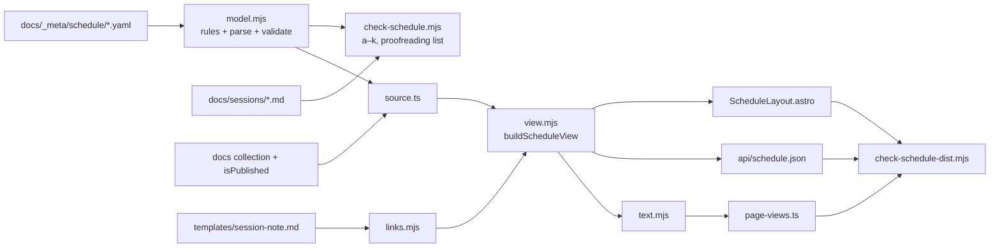

# Implementation Plan: Living schedule and session notes

**Branch**: `feat/living-schedule` | **Date**: 2026-10-23 | **Spec**: [spec.md](./spec.md)
**Input**: Mission specification from `kitty-specs/living-schedule-01M5N5QA/spec.md`

## Summary

Publish the SoCraTes BE 2026 session board as per-day YAML data under
`docs/_meta/schedule/`, read and validated by one pure module (`model.mjs`) that
the page, the API route, the check scripts and the unit tests all share. A single
view-model builder joins rooms, days, slots and note state, so every renderer
agrees by construction. The page is a regular docs page
(`docs/sessions/schedule.md`, `kind: Schedule`) rendered by a theme kind layout in
the normal page frame: a per-slot list on phones and a room × slot table in a
scrolling region from about 64rem, both without JavaScript. Each session links
"Read the notes" to its published session note or "Start the notes" to a GitHub
new-file URL prefilled from a single template file. Agents get
`api/schedule.json` and the schedule as text in the page's machine views. A
fixture-proven PR check, unit tests, a post-build checker with its own self-test,
and a separate two-day fixture build guard it all. Planning was preceded by a
research squad and followed by post-spec and post-plan review squads; see
[research.md](./research.md).

## Technical Context

**Language/Version**: TypeScript 5.9 and Astro 7.4 (`.astro`, `.ts`) for the site; plain ES modules (`.mjs`) on Node 24 (CI) / Node ≥ 22.23 (engines) for shared logic and scripts
**Primary Dependencies**: Astro 7.4, Starlight 0.42.6, `@spec-kitty/doc-toolkit` 0.4.0 (DocKitty), `yaml` 2.9 and `gray-matter` 4 (both already in `package.json`); no new dependencies (C-004)
**Storage**: Repository files: `docs/_meta/schedule/rooms.yaml`, `docs/_meta/schedule/<YYYY-MM-DD>.yaml`, `docs/_meta/templates/session-note.md`; session notes in `docs/sessions/`
**Testing**: `node:test` via `node --test "tests/**/*.test.mjs"` (no dependency); check-script fixtures expressed as text patches on a valid fixture; post-build checker with its own mutation self-test; a two-day fixture build in a separate CI step; the prefilled body validated by spawning `dockitty-validate-frontmatter` on a temporary tree
**Target Platform**: Static site on GitHub Pages (`/socratesbe_26_secondbrain/`); phones first; usable without JavaScript
**Project Type**: Single project (Astro static docsite)
**Performance Goals**: Build time increase < 10 s and full build < 60 s (baseline 3.2 s measured on 2026-10-23, NFR-005); schedule check < 5 s (dual parse of 200 sessions measured at 15 ms, NFR-006)
**Constraints**: No participant names (C-001); no new dependencies (C-004); static and time-independent (C-006); theme tokens only, colour-literal guard extended to the new stylesheet (C-003a); a published page never links to a draft
**Scale/Scope**: 1 day transcribed now (49 sessions, 8 rooms, 10 slots), up to 4 days (22–25 October 2026), about 200 sessions at most

## Charter Check

*GATE: Must pass before Phase 0 research. Re-check after Phase 1 design.*

| Charter item | Status | How the plan meets it |
|---|---|---|
| P1 One source, two audiences | Pass, with a recorded exception | The schedule's single source is YAML, not Markdown. The page, `api/schedule.json` and the text views come from one view model; the parity check enforces equality. ADR 0003 records the exception (FR-025). |
| P2 Unconference spirit | Pass | Notes publish on merge; one file per note; prefilled start; Slack fallback. |
| P3 People first (no participant names) | Pass | Closed data shape with no person field (FR-019 i); comments forbidden so nothing hides outside parsed values (FR-019 c); proofreading list in the checks summary (FR-020); template without convener heading or prefilled handle; generic commit messages for data commits. |
| P4 Agents draft, humans decide | Pass | Every change is a reviewed PR; writers of schedule YAML use the site's YAML 1.1-compatible options. |
| P5 Stay on the convention | Pass | Regular docs page; theme layout via the toolkit's kind registry (open vocabulary, toolkit ADR-0009, non-fatal `validate` warning); `--dk-*`/`--sb-*` tokens only. |
| Quality gates | Pass, extended | New named CI steps "Schedule data", "Unit tests" and "Schedule fixture build"; the post-build checker joins `check:dist`. Charter and AGENTS.md list them (FR-025, FR-023). |
| Performance (build < 1 min, no-JS pages) | Pass | Baseline 3.2 s; layouts are HTML and CSS only. |
| Deployment (static, no credentials) | Pass | Static output; no new dependencies; fixture output never uploaded. |

Post-design re-check: passing; no violations to justify.

## Project Structure

### Documentation (this mission)

```
kitty-specs/living-schedule-01M5N5QA/
├── spec.md, plan.md, research.md, data-model.md, quickstart.md
├── contracts/ (schedule-day, schedule-rooms, api-schedule schemas; start-notes-url.md)
├── checklists/requirements.md
└── decisions/
```

### Source Code (repository root)

```
site.config.mjs                        # OWNER, REPO, SITE, BASE; imported by astro.config.mjs and links.mjs

docs/
├── _meta/
│   ├── schedule/
│   │   ├── rooms.yaml                 # event-wide rooms (list order = board order)
│   │   └── 2026-10-23.yaml            # Friday board
│   └── templates/session-note.md      # single source of the note template (validated, not published)
├── sessions/README.md                 # hub: hand-kept list removed, schedule CTA, Slack fallback
├── sessions/schedule.md               # kind: Schedule, tableOfContents: false, sidebar.order
├── README.md                          # home hero: schedule CTA
├── guides/add-a-session-note.md       # rewritten (slice 1)
└── adr/0003-schedule-as-structured-data.md

src/
├── lib/schedule/
│   ├── model.mjs                      # pure: read dir, writing rules, parse, validate (FR-019 a–i), identity rule
│   ├── view.mjs                       # pure: buildScheduleView(rooms, days, publishedIds, site) → one view model
│   ├── links.mjs                      # pure: note state, prefill URL (two substitutions), length fallback
│   ├── text.mjs                       # pure: view model → Markdown text for agents (absolute links, no prefill URLs)
│   └── source.ts                      # Astro glue: data dir (SCHEDULE_DATA_DIR or docs/_meta/schedule),
│                                      #   published ids from getCollection('docs') + isPublished; throws on bad data
├── lib/page-views.ts                  # + splice text.mjs output into the schedule page's record only
├── pages/api/schedule.json.ts         # machine-readable schedule from the view model
└── theme/
    ├── index.ts                       # + layouts: { Schedule: here('./ScheduleLayout.astro') } (local cast), + schedule.css
    ├── ScheduleLayout.astro           # list + table, jump links, day switcher, sections, snapshot; data-* markers
    └── schedule.css                   # tokens only

scripts/
├── check-schedule.mjs                 # PR check: model.mjs (a–i) + notes (j, k) + proofreading list + orphan warnings; fixtures self-test
├── check-schedule-dist.mjs            # post-build: no-JS, per-layout counts, parity, collisions, sentinel; own self-test
├── check-theme-literals.mjs           # + src/theme/schedule.css
└── fixtures/schedule/
    ├── valid/                         # rooms.yaml, day file(s), sessions/ with one published note
    ├── patches.mjs                    # must-fail fixtures as {file, find, replace, expect:{class, location}}
    └── two-day/                       # FR-010 fixture data with a FIXTURE-SENTINEL title

tests/schedule/*.test.mjs              # node:test for model, view, links, text, identity
.github/workflows/docsite.yml          # + "Schedule data", "Unit tests" (before Build); "Schedule fixture build" + check (after check:dist)
package.json                           # + check:schedule, test; check:dist chains check-schedule-dist.mjs
```

**Structure Decision**: Single Astro project. There is no content-collection loader for the schedule: `source.ts` calls `model.mjs` while the page renders, so `astro dev` picks up YAML edits on refresh, the build fails on bad data, and validation exists in exactly one place. `model.mjs` is the only validator; the JSON Schemas in `contracts/` document the shape and a unit test checks the valid fixture against them by hand-written assertions (no schema library, C-004). The precedent for one `.mjs` shared by Astro and bare node is `src/lib/yaml-view-options.mjs`.



### Rendering decisions

- **Frame**: normal docs frame (sidebar and mobile menu kept), `tableOfContents: false`, no `template: splash` (splash caps content near 67.5rem anyway and removes the mobile menu). The table lives in a focusable `role="region"` scroll wrapper with a sticky slot column.
- **Markers**: the schedule root carries `data-schedule`; each layout `data-layout="list|table"`; each session `data-session-id`, `data-note-state="published|none"` and, when published, `data-note-id`.
- **Prefill weight**: the prefill URL appears only in the list layout; table cells link to the session's list anchor. The text view carries note state, not prefill URLs.
- **Links in text views**: absolute and under the site prefix, as `check-md-views.mjs` requires.

### Validation decisions

- **Writing rules (FR-019 c)**: no comments (any `#` comment token from the YAML lexer), every text value quoted (checked on the parsed node's scalar type), `uncertain` a bare boolean, and YAML 1.1 and 1.2 parses agree. Agents writing schedule YAML use `YAML_OPTIONS` from `src/lib/yaml-view-options.mjs`.
- **Order and uniqueness of findings**: classes run in the spec's order; a fault reports once under the first class it matches.
- **Draft rule in the check (FR-019 j)**: `(doc_status ?? 'draft') === 'draft'`, copied from the toolkit's `isDraftStatus` (`lib/vocabulary-core.mjs`, not exported) with a citation comment and a test that a note without `doc_status` counts as a draft. Notes are read with `gray-matter`. The site itself uses `isPublished` through `source.ts`.
- **Identity uniqueness**: across schedule data only; a session's own note is its join, not a collision.

## Complexity Tracking

No charter violations to justify.

## Implementation Concern Map

Slice markers follow the spec's Delivery Slices (S1 core, S2 same PR, S3 last).

### IC-01 — Data model and validation core

- **Purpose**: One pure module that reads, checks and parses schedule data and forms identities.
- **Relevant requirements**: S1: FR-001, FR-001a, FR-001b, FR-014, FR-019 (a)–(i), FR-019a, NFR-007, C-001, C-009. S2: FR-014a (documented procedure, quickstart).
- **Affected surfaces**: `src/lib/schedule/model.mjs`, `scripts/fixtures/schedule/valid/`, `scripts/fixtures/schedule/patches.mjs`, `tests/schedule/model.test.mjs`
- **Sequencing/depends-on**: none
- **Risks**: fixtures built from objects lose quoting, so must-fail fixtures are text patches with a unique `find`; identity edge cases (empty slug, truncation, suffix within 60).

### IC-02 — Friday board transcription

- **Purpose**: The 23 October board as data, without names, with the transcription rules applied.
- **Relevant requirements**: S1: FR-002, FR-002a, FR-007, FR-008, SC-001, C-001, C-002
- **Affected surfaces**: `docs/_meta/schedule/rooms.yaml`, `docs/_meta/schedule/2026-10-23.yaml`, `kitty-specs/living-schedule-01M5N5QA/identity-checklist.md`
- **Sequencing/depends-on**: IC-01
- **Risks**: names in titles, descriptions or identities; transcription notes copied as descriptions; the "(Thursday)" sticky; exactly two uncertain. The source HTML is never committed. Commit messages stay generic.

### IC-03 — Checks wiring and CI

- **Purpose**: Run the PR check (with note classes j and k, the proofreading list and orphan warnings), the unit tests and the post-build checks in CI as named steps.
- **Relevant requirements**: S1: FR-019 (j)–(k), NFR-006a, NFR-008. S2: FR-020, NFR-006. S3: FR-024.
- **Affected surfaces**: `scripts/check-schedule.mjs`, `package.json`, `.github/workflows/docsite.yml`
- **Sequencing/depends-on**: IC-01
- **Risks**: the proofreading list must go to `$GITHUB_STEP_SUMMARY`; orphan warnings only for date-prefixed note files.

### IC-04 — Schedule page, view model and layout

- **Purpose**: Render the schedule for humans from one view model.
- **Relevant requirements**: S1: FR-004, FR-005, FR-006, FR-007, FR-008, FR-009, FR-011, FR-018 (schedule surface), NFR-001, NFR-001a, NFR-002, C-003, C-003a, C-006, C-008. S2: FR-003, NFR-003, FR-010, FR-010a.
- **Affected surfaces**: `src/lib/schedule/view.mjs`, `src/lib/schedule/source.ts`, `docs/sessions/schedule.md`, `src/theme/ScheduleLayout.astro`, `src/theme/schedule.css`, `src/theme/index.ts`, `scripts/check-theme-literals.mjs`, `site.config.mjs`, `astro.config.mjs`
- **Sequencing/depends-on**: IC-01, IC-05
- **Risks**: Starlight's Markdown table CSS (use `not-content`); Pagefind drops `<nav>` and would index sessions twice (`data-pagefind-ignore` on the hidden layout); `Kind` type needs a local cast; register the layout with `here()`; the layout's single slot means the schedule renders before the page body block.

### IC-05 — Session notes: template, note state and prefill

- **Purpose**: One template file; note state from published ids; a valid, capped prefill with a plain fallback.
- **Relevant requirements**: S1: FR-012, FR-013, FR-013a, FR-015, FR-022, NFR-004, C-005. S3: FR-013b.
- **Affected surfaces**: `docs/_meta/templates/session-note.md`, `src/lib/schedule/links.mjs`, `tests/schedule/links.test.mjs`
- **Sequencing/depends-on**: IC-01
- **Risks**: undocumented GitHub prefill (FR-013a, FR-013b); title cap of 100 characters keeps links far below 4,000 (measured 812–1,232).

### IC-06 — Agent surfaces and post-build checks

- **Purpose**: `api/schedule.json`, the text splice, and `check-schedule-dist.mjs` (no-JS, per-layout counts, parity, collisions, sentinel) with its own self-test; the two-day fixture build.
- **Relevant requirements**: S1: FR-005 (dist assertions), FR-012/FR-022 (fixture build), NFR-008. S2: FR-021, FR-021a, FR-021b, FR-010/FR-010a (fixture build).
- **Affected surfaces**: `src/pages/api/schedule.json.ts`, `src/lib/schedule/text.mjs`, `src/lib/page-views.ts`, `scripts/check-schedule-dist.mjs`, `scripts/fixtures/schedule/two-day/`
- **Sequencing/depends-on**: IC-04, IC-05
- **Risks**: `astro build --outDir` must stay on the same filesystem (`dist-fixture/`, gitignored); `SCHEDULE_DATA_DIR` set only on the fixture step; parity compares normalised (state, id) pairs and requires non-empty sets equal to the data.

### IC-07 — Hub, home, guide and rules

- **Purpose**: Make the schedule reachable on phones and bring the written instructions in line.
- **Relevant requirements**: S1: FR-016, FR-017, FR-018, FR-023. S2: FR-025.
- **Affected surfaces**: `docs/sessions/README.md`, `docs/README.md`, `docs/guides/add-a-session-note.md`, `AGENTS.md`, `.kittify/charter/charter.md`, `docs/adr/0003-schedule-as-structured-data.md`
- **Sequencing/depends-on**: IC-04 (page to link), IC-03 (gates to document)
- **Risks**: a published hub must not link a draft; the intro of `schedule.md` links `api/schedule.json` with the right relative depth.

## Verification Strategy

| Requirement | Verification |
|---|---|
| FR-001–FR-001b, FR-014 | Unit: identity rule incl. empty slug, truncation, suffix within 60; valid fixture with a cross-day move and one published note produces no finding |
| FR-002, FR-002a, SC-001 | Unit on real data: 49 sessions, 8 rooms, 10 slots, exactly 2 uncertain, ids match the identity checklist; reviewer attestation for names |
| FR-003, NFR-003 | Dist: the table has a caption, `th scope="col"` per room in board order, `th scope="row"` per slot |
| FR-004, NFR-001, NFR-001a | Manual 375px screenshot; dist: no fixed widths in the list layout; CSS minimum target size |
| FR-005 | Dist: per-layout `data-session-id` sets equal the data (≥ 1); script set ⊆ a control docs page's; no script, `on*=`, custom element, template or hidden session inside `[data-schedule]`; jump and day links resolve |
| FR-006, FR-007, FR-008, FR-011 | Dist on real data: room size and equipment words; section headings and the 17:30 time; question-title session not flagged, the two cut-off ones flagged; snapshot HH:MM and "board is authoritative" text |
| FR-010, FR-010a | Fixture build (two-day): switcher present, newest first; real build: no switcher |
| FR-012, FR-022 | Fixture build with published, draft (drafts built) and missing notes: ≥ 1 "Read" and ≥ 1 "Start"; no link to the draft |
| FR-013, NFR-004 | Unit: decoded filename and body; body validated by spawning `dockitty-validate-frontmatter`; synthetic over-long prefill falls back |
| FR-013a, FR-018 | Dist: fallback link next to each Start link; Slack text on the schedule and hub |
| FR-013b | Manual evidence record (three runs) |
| FR-015, C-005 | Template validated by `pnpm validate`; class (k) guards an unedited placeholder |
| FR-016, FR-017 | Dist: hub has no hand list and a schedule link before the notes list; home has a schedule link in the hero |
| FR-019, NFR-007 | Self-test: each patch yields exactly its class and location; valid yields none |
| FR-019a | Unit/dev: `source.ts` throws on unreadable and on empty data; valid data builds |
| FR-020 | Fixture with a distinct marker in each free-text field; every marker appears in the summary |
| FR-021–FR-021b | Dist: parity of normalised (state, id) across HTML, `api/schedule.json` and `schedule.md`; unique output paths; hand-written shape assertion of the API against the contract |
| FR-023, FR-025 | Review; `pnpm validate`, `lint:md`, `links`, `spell` |
| FR-024 | Unit: date-prefixed orphan warns; the existing untied note does not |
| NFR-005, NFR-006 | Timings recorded before and after |
| NFR-008 | CI shows the named steps; dist check asserts the sentinel is absent from `dist/` |
| C-004 | `package.json` dependency sets unchanged against `main` |
| C-006 | No `Date.now`/`new Date()` without arguments in `src/lib/schedule/`; two builds produce identical schedule HTML |

Never run a full heavy suite (`NO_FULL_HEAVY_SUITES_IN_MISSION`); run targeted checks per change.
