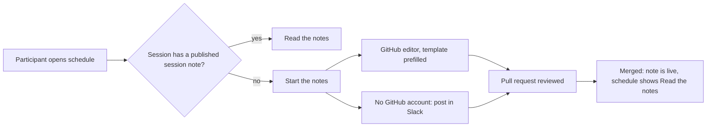

# Mission Specification: Living schedule and session notes

**Mission Branch**: `feat/living-schedule`
**Created**: 2026-10-23
**Status**: Draft (revised after the post-spec adversarial review)
**Input**: User description: "Load and add the timetable to the context / docsite. And prepare a template / session TLDR page, as well as a session hub. The idea being people can contribute their notes, learnings, references, and writeups from specific sessions. We want the docsite to be a living artefact, allowing people to use it to see the current agreed upon schedule."

## Intent Summary

A participant of SoCraTes BE 2026, usually on a phone at the venue, wants to know
where and when a session takes place, and afterwards wants to add notes about it.
The agreed session board is published on the second brain for each day of the
unconference and kept current by pull request. Each session on it shows whether
a session note exists and offers one obvious way to read it or start it. Session
notes follow a short TL;DR template and appear on the site as soon as their pull
request is merged. The sessions hub lists every published session note and points
to the schedule. No participant name appears anywhere, and agents can read the
same schedule that humans see.

Confirmed decisions (Decision Moments, all resolved):

- Session notes publish on merge; the pull-request review is the gate. There is no
  "in progress" state on the schedule.
- The board's sticky colours and "framed" outline are decoration and are not
  transcribed.
- The first release is ready for several days but transcribes only the board of
  Friday 23 October 2026. A day switcher appears once a second day exists. Slot
  jump links stand in for a live "now" marker; nothing depends on the current time.
- Participants without a GitHub account are invited to post notes in the
  SoCraTes Slack, where a maintainer turns them into a pull request.

## User Scenarios & Testing *(mandatory)*

### User Story 1 - Find a session on today's schedule (Priority: P1)

A participant standing in the hallway opens the second brain on a phone to find
out what runs in the next slot and in which room.

**Why this priority**: It is the primary reason to open the site during the
event, and every other story builds on the schedule existing.

**Independent Test**: Publish the Friday board and inspect the built schedule at
375px and 1280px wide. All 49 sessions are present, each with its room or place,
and the page states which day and which board snapshot it shows.

**Acceptance Scenarios**:

1. **Given** the Friday board is published, **When** a participant opens the
   schedule on a phone, **Then** they see the sessions grouped by slot, each with
   its room (name, size and equipment in words), title and description, without
   scrolling sideways.
2. **Given** the same board, **When** the schedule is opened on a wide screen,
   **Then** it is laid out as a grid with rooms as columns in the board's order and
   slots as rows by start time; a cell may hold several sessions, in board order;
   lunch, closing and dinner are rows across the grid.
3. **Given** the participant wants a later slot, **When** they use the slot jump
   links at the top, **Then** the page moves to that slot.
4. **Given** a sticky was cut off or partly illegible on the board, **When** it is
   shown, **Then** it is marked as uncertain with an invitation to correct it.
5. **Given** a session whose title is a question (for example "Did I lock the
   door?"), **When** it is shown, **Then** it is not marked as uncertain.
6. **Given** sessions outside the room grid, **When** the participant scrolls past
   the grid, **Then** each section ("Lunch tables", "Outside", "Evening", "Other /
   not yet scheduled") is listed under its own heading, and a section session with
   a start time (the outside session at 17:30) shows that time.
7. **Given** a day's schedule, **When** it is shown, **Then** it states the date and
   local time (Europe/Brussels, HH:MM) of the board snapshot and that the board in
   the venue is authoritative.

---

### User Story 2 - Start the notes for a session (Priority: P1)

After a session, a participant wants to write down what the group discussed and
learned, starting from the schedule entry of that session.

**Why this priority**: Collecting notes is the purpose of the second brain; the
schedule is the natural entry point to it.

**Independent Test**: From a session without a session note, follow "Start the
notes", submit the prefilled note, merge it, and check that the built site shows
the note and the schedule entry now says "Read the notes".

**Acceptance Scenarios**:

1. **Given** a session without a session note, **When** the participant selects
   "Start the notes", **Then** GitHub opens a new file named after the session's
   identity in the sessions section, with the TL;DR template prefilled with the
   session's title.
2. **Given** the prefilled editor does not work for them, **When** they look next
   to the action, **Then** a plain fallback explains where to copy the template
   from.
3. **Given** a participant without a GitHub account, **When** they look at the
   schedule or the sessions hub, **Then** they are invited to post their notes in
   the SoCraTes Slack instead.
4. **Given** a session note pull request is reviewed and merged, **When** the site
   is rebuilt, **Then** the note is published and its schedule entry links to it.
5. **Given** a session title containing `:`, `?`, `&` or a leading `#`, **When** its
   "Start the notes" link is decoded, **Then** the file name equals the session's
   note path and the decoded body passes the site's frontmatter validation
   unchanged.

---

### User Story 3 - Read and extend the notes of a session (Priority: P2)

A participant who missed a session, or who wants to add a reference or a later
write-up, opens its session note from the schedule or the sessions hub.

**Why this priority**: Notes gain value as more people add to them, but this
depends on stories 1 and 2.

**Independent Test**: With one published session note, reach it from both the
schedule and the sessions hub, and find the write-ups section to append to.

**Acceptance Scenarios**:

1. **Given** a session with a published session note, **When** the participant
   selects "Read the notes" on the schedule, **Then** the note opens.
2. **Given** the sessions hub, **When** it is opened, **Then** it lists every
   published session note automatically, shows a schedule link within the first
   screen at 375px, and offers the way to add notes.
3. **Given** a session note following the template, **When** someone wants to add a
   blog post written later, **Then** there is a dedicated write-ups section.
4. **Given** two people start the same session's note at the same time, **When** the
   second pull request conflicts, **Then** the guide tells them to add to the
   existing note instead.

---

### User Story 4 - Keep the schedule current (Priority: P2)

During the day a session moves to another room or slot, or a new one is added.
A participant (or an organiser) updates the schedule with a small pull request.

**Why this priority**: "Living artefact" is the operator's core requirement, but
the first value is delivered by publishing the board at all.

**Independent Test**: Move one session to another slot and room, and rename its
title, in the schedule data; only that session's values change, the checks pass,
and its session note link still works.

**Acceptance Scenarios**:

1. **Given** a session with a session note, **When** its room, slot, day or title
   changes, **Then** its note stays linked, because its identity does not change.
2. **Given** a contributor introduces any one of the validation errors listed in
   FR-019, **When** the checks run on the pull request, **Then** they fail and the
   message names the error class and its location.
3. **Given** valid schedule data, **When** the checks run, **Then** they pass.
4. **Given** a second day's board is added as schedule data only, **When** the site
   is built, **Then** a day switcher appears; **Given** only one day exists,
   **Then** no day switcher is shown.
5. **Given** a reviewer, **When** they review a schedule change, **Then** they can
   read every free-text value of the schedule as a plain list in the pull
   request's checks summary.

---

### User Story 5 - An agent reads the schedule (Priority: P3)

An LLM agent that starts from the site's `llms.txt` wants the current schedule
and the session notes linked to it.

**Why this priority**: Equal service to agents is a charter principle, but the
event audience is mostly human.

**Independent Test**: Starting from `llms.txt` only, an agent reaches the schedule
page, its text version and the machine-readable schedule, and all three list the
same sessions with the same note links.

**Acceptance Scenarios**:

1. **Given** `llms.txt`, **When** an agent follows it, **Then** it reaches the
   schedule page, whose text version lists every session and links the
   machine-readable schedule.
2. **Given** the built site, **When** the parity check runs, **Then** the set of
   session identities and the note link of each are identical in the human page,
   the text version and the machine-readable schedule.

### Edge Cases

- A cell holds several sessions at once (the board has up to three); all are shown
  in board order.
- A session has no slot (it sits in a section) or takes place outside a room.
- Lunch, closing and dinner are rows of the day, not sessions. The board shows
  closing and dinner in a separate block; the schedule shows them as rows after
  the last session slot.
- The eight decorative stickies in the lunch row are not sessions and are not
  transcribed.
- Titles contain emoji, "…", `:`, `?`, `&`, `@`, `%`, an em dash, apostrophes,
  `!`, parentheses or a leading `#`, or are very short (two letters).
- A session is renamed to fix a typo: its identity, and so its note link, stays.
- A session note exists as a draft for a scheduled session: the checks fail and
  ask the contributor to publish it, so "Start the notes" never points at a file
  that already exists.
- A session note exists for a session that is no longer on the schedule: it stays
  on the hub; the checks warn about it but do not fail.
- Only one day exists: no day switcher is shown. Several days exist: the most
  recent board day is shown first.
- The schedule data cannot be read, or is empty: the build and the checks fail
  instead of publishing an empty schedule.
- The physical board changes faster than pull requests merge: the page states it
  is a transcription of the board at a given time and that the board is
  authoritative.

## Domain Language

| Canonical term | Meaning | Avoid |
|---|---|---|
| Marketplace | The opening where sessions are proposed on the board; a "marketplace session" is a Session | — |
| Session | One proposal on the board (one sticky) with a title and an optional description | talk, track |
| Board | The physical session wall at the venue ("sticky wall") | Miro, wall chart |
| Schedule | The published transcription of the board for one or more days | timetable (in UI text), agenda |
| Slot | A time row of a day (for example 13:30): session, lunch, closing or dinner | time slot, period |
| Room | A named place with a size (XL, L, S) and equipment, with a short key used in references | venue |
| Place | Where a session happens when it is not a room (outside, a lunch table, the cafeteria) | room |
| Section | A group of sessions outside the room grid: Lunch tables, Outside, Evening, Other / not yet scheduled | category |
| Session identity | The permanent key of a session; also the name of its session note file | slug (in UI text) |
| Session note | The page with what a session discussed and learned | write-up (that is a section of the note) |
| Sessions hub | The "Sessions" page that lists all published session notes | index |
| Convener | The person who proposed a session; never named on the site | host, speaker |

## Requirements *(mandatory)*

### Functional Requirements

| ID | Title | User Story | Priority | Status | Delivery | No-op passable? |
|----|-------|------------|----------|--------|----------|-----------------|
| FR-001 | Schedule data | As a contributor, I want the schedule kept as structured data in the repository: rooms for the whole event (key, display name, size, equipment, board order), and per day its date, board snapshot time (Europe/Brussels), slots (start time and type: session, lunch, closing or dinner) and sessions, so that the schedule can be edited by pull request. | High | Open | [build] | no |
| FR-001a | Session record | As a contributor, I want each session to carry an identity, a title of at most 100 characters, an optional description of at most 140 characters (counted in Unicode code points), a location (exactly one of a room key or a place, the place being a short display label such as "Outside" or "Cafeteria"), a timing (exactly one of a slot or a section, a section session optionally with a start time) and an optional uncertain flag, and no other field, so that the board is captured without inventing structure. | High | Open | [build] | no |
| FR-001b | Identity rule | As a contributor, I want a new session's identity formed as the date of the day it is first added, a hyphen, and the title reduced to lowercase ASCII letters, digits and single hyphens (accents removed, other characters dropped; `session` when nothing is left), cut to at most 60 characters without a trailing hyphen, and unique across all schedule data (on a collision append `-2`, `-3`, … within the 60 characters), so that every contributor forms identities the same way. The check validates the identity's shape (a valid date prefix and the character rule), not that the prefix equals the day the session is now in. | High | Open | [build] | no |
| FR-002 | Friday board transcribed | As a participant, I want the board of Friday 23 October 2026 transcribed: 8 rooms, 7 session slots plus lunch, closing (18:30) and dinner (19:30), and all 49 sessions (35 in the grid; 2 lunch tables, 1 outside at 17:30, 4 evening, 7 other or not yet scheduled), with titles and descriptions as written and no participant names, so that the schedule is usable at the event. | High | Open | [build] | no — checked against the identity checklist of 49 sessions |
| FR-002a | Transcription notes | As a participant, I want transcription notes on the board ("cut off in photo", hard to read) turned into the uncertain flag rather than copied as descriptions, all other description text copied as written, and a sticky that names another weekday kept on the board and in the section where it was found with the day in its description, so that the schedule reflects the board and nothing is invented. | Medium | Open | [build] | no |
| FR-003 | Grid on wide screens | As a participant on a desktop, I want the schedule shown as a grid with rooms as columns (board order) and slots as rows (start time), several sessions per cell (board order), and lunch, closing and dinner as rows across the grid, so that I can see the whole day at once. | High | Open | [build] | no |
| FR-004 | Slot list on phones | As a participant on a phone, I want the same schedule shown as a list grouped by slot, each session showing its room or place in the same block as its title, without sideways scrolling, so that I can read it standing up. | High | Open | [build] | no |
| FR-005 | Works without scripts | As any reader, I want the schedule to work without JavaScript, verified on the built output: each layout contains every session identity from the data exactly once (count equal to the data and at least one); the schedule page loads no script beyond those every docs page loads; the schedule area contains no script, event-handler attribute, custom element, template or hidden session; and every slot jump link and day-switcher link is a plain link whose target exists, so that the page is usable on any device. | High | Open | [build] | no — positive control: the session count from the data, read independently of the page |
| FR-006 | Room facts in words | As a participant, I want each room's size and equipment shown as words (any icon is decorative only), and a room without equipment to show its size only, so that the information does not depend on symbols or colour. | Medium | Open | [build] | no |
| FR-007 | Sections outside the grid | As a participant, I want the board's sections listed under the board's own headings ("Lunch tables", "Outside", "Evening", "Other / not yet scheduled") after the grid, with a section session's start time when it has one, so that nothing on the board is lost. | Medium | Open | [build] | no |
| FR-008 | Uncertain entries flagged | As a participant, I want a session marked uncertain only when its sticky was cut off or partly illegible (exactly two on the Friday board), shown with an invitation to correct it, and never because its title or description contains a question mark, so that errors get fixed and questions are not mislabelled. | Medium | Open | [build] | no — paired with a question-title session that must not be flagged |
| FR-009 | Slot jump links | As a participant, I want links at the top of a day's schedule that jump to each slot, so that I can reach the next slot quickly. | Medium | Open | [build] | no |
| FR-010 | Add a day by data | As a contributor, I want to add another day's board by adding schedule data only, with all days on one schedule page, so that the schedule grows with the event. | Medium | Open | [build] | no — verified by building the real page with a two-day fixture |
| FR-010a | Day switcher | As a participant, I want a day switcher (plain links, current day marked in words) when more than one day exists, none while only one exists, and the most recent board day shown first, so that I land on the relevant day without anything depending on the current time. | Medium | Open | [build] | no — one-day and two-day builds compared |
| FR-011 | Snapshot statement | As a participant, I want each day's schedule to state the date and local time (HH:MM, Europe/Brussels) of the board snapshot and that the board in the venue is authoritative, so that I know how current it is. | Medium | Open | [build] | no |
| FR-012 | Notes link per session | As a participant, I want each session to show "Read the notes" linking to its session note when a published session note exists, and "Start the notes" when no session note file exists, so that I can always take the next step. | High | Open | [build] | no — checked on a fixture build with one published note, one draft note (drafts built) and one missing note, asserting at least one of each link |
| FR-013 | Prefilled new note | As a contributor, I want "Start the notes" to open GitHub's editor for a new file named `<session identity>.md` in the sessions section, prefilled with the template with two substitutions only, the session's title and an `updated` date equal to the session's day (for a deterministic link; room and slot are not copied), whose decoded body passes the site's frontmatter validator unchanged, so that starting notes takes seconds and stays valid when the session moves. | High | Open | [build] | no — decoded for a title with `:`, `?`, `&` and a leading `#` |
| FR-013a | Plain fallback | As a contributor, I want a plain fallback next to every "Start the notes" link that points to the template and the guide, so that I can contribute when the prefilled editor does not work. | Medium | Open | [build] | no |
| FR-013b | Prefill verification recorded | As the operator, I want an evidence page listing the three manual runs of "Start the notes" (desktop with write access, an account without write access through the fork flow, a phone browser) with a column for whether the prefill survived, the outcomes being recorded through a tracked follow-up issue, so that the phone and fork behaviour gets verified rather than assumed. Cut to a follow-up by the operator on 2026-10-24 (Follow-up: #15). | Medium | Open | [build] | no |
| FR-014 | Identity is stable | As a contributor, I want a session's identity to stay the same when its title, room, slot or day changes, including a move to another day's file, so that session notes never get orphaned by schedule moves. | High | Open | [build] | no — a moved (including across days) and renamed session keeps its note link and passes the checks |
| FR-014a | Name removal exception | As a maintainer, I want the only permitted identity change to be removing a participant name from it, done by renaming the session note file in the same pull request, so that a name that slipped through can still be removed everywhere. | Medium | Open | [build] | no |
| FR-015 | Session note template | As a contributor, I want one session note template with the sections TL;DR, What we discussed, Learnings, Open questions and follow-ups, References and Write-ups, a no-names reminder at the top, no convener heading, `doc_status: active`, and an optional, commented-out `authors` line with no prefilled handle, so that session notes are consistent and publish on merge. | High | Open | [build] | no |
| FR-016 | Hub lists published notes | As a participant, I want the sessions hub to list published session notes through its existing automatic listing, with the hand-kept list and the "publish as a draft" advice removed, so that adding a session note means editing one file. The schedule page appears as a hub child; that is intended. | High | Open | [build] | no |
| FR-017 | Schedule reachable on phones | As a participant, I want a schedule link in the page content (not only the header) within the first screen at 375px on both the sessions hub and the home page, so that I can reach the schedule even though header links are hidden on small screens. | Medium | Open | [build] | no |
| FR-018 | Slack fallback | As a participant without a GitHub account, I want the schedule and the sessions hub to tell me I can post my notes in the SoCraTes Slack, where a maintainer opens the pull request, so that I can still contribute. | Medium | Open | [build] | no |
| FR-019 | Schedule validated | As a maintainer, I want the pull-request checks to fail, naming the error class and its location and reporting exactly one finding per fault, when the schedule data: (a) cannot be read; (b) is empty; (c) breaks the writing rules: contains a comment, has a text value that is not quoted, has an `uncertain` value that is not a bare `true` or `false`, or has a value that the YAML 1.1 and 1.2 rules read differently; (d) misses a required field or has one that is empty (title, identity, snapshot); (e) has a duplicate session identity; (f) has an identity that breaks FR-001b; (g) references an unknown room or slot, or a slot of a type other than session; (h) gives a session both or neither of room and place, or both or neither of slot and section; (i) contains a field outside the allowed set, in particular any person field; (j) leaves a session note for a scheduled session in draft (a note without `doc_status` counts as a draft, as on the site); (k) leaves a session note's description equal to the template placeholder. Classes are checked in this order, so a fault is reported under the first class it matches. So that a broken schedule never deploys. | High | Open | [build] | no — each class has a must-fail fixture written as a single text change to the valid fixture, producing exactly that one finding; the valid fixture, including a published note for one session and a session moved across days, produces none |
| FR-019a | Build refuses bad data | As a maintainer, I want the site build itself to fail on unreadable or empty schedule data, so that nothing bypasses the checks into a deployment. | High | Open | [build] | no — positive control: valid data builds |
| FR-020 | Proofreading list | As a reviewer, I want the pull-request checks summary to show every free-text value of the schedule (titles, descriptions, room names, place labels, session identities) as a plain list (comments cannot hide text because FR-019 (c) forbids them), so that I can proofread a schedule change for participant names without reading raw data. | Medium | Open | [build] | no — fixture with a distinct marker in each free-text field; every marker must appear |
| FR-021 | Machine-readable schedule | As an agent, I want a machine-readable version of the full schedule (days, rooms, slots, sessions, note links) at its own URL beside the agent API (`api/schedule.json`, as `api/bibliography.json` already is), distinct from the schedule page's per-page view paths, so that I can use the schedule without parsing HTML. | High | Open | [build] | no |
| FR-021a | Text version for agents | As an agent, I want the schedule page's text version (its Markdown, JSON and YAML page views) to contain the schedule as text and a link to the machine-readable schedule, so that `llms.txt` leads me to the full schedule. | Medium | Open | [build] | no |
| FR-021b | Parity check | As a maintainer, I want a build check that the set of session identities and each session's note state and note target are identical in the human page, the text version and the machine-readable schedule and equal to the data (never empty), compared after normalising link forms, and that no two outputs claim the same path, so that agents and humans read the same schedule. | Medium | Open | [build] | no |
| FR-022 | No link to unpublished notes | As a maintainer, I want the schedule and its agent versions to link only to published session notes, so that a published page never links to a draft. | High | Open | [build] | no — checked on the same fixture build as FR-012 |
| FR-023 | Guide and rules updated | As a contributor, I want the "Add a session note" guide to describe starting notes from the schedule, the template, publishing on merge, the Slack fallback, what to do when a note already exists, and the no-names rule (dropping step 4 "add a line to the list" and the `doc_status: draft` advice for session notes), and AGENTS.md to state that session notes are published on merge, so that the written instructions match the site. | Medium | Open | [build] | no |
| FR-024 | Orphan notes reported | As a maintainer, I want the checks to warn (not fail) about session note files whose name has the session-identity date prefix but matches no session, so that mismatched identities are noticed without warning about older notes that were never tied to the board. | Low | Open | [build] | no — paired with the existing untied note, which must not warn |
| FR-025 | Decision recorded | As a future maintainer, I want a decision record explaining why the schedule is structured data rather than a Markdown page and how agents still receive it, and the charter's quality gates and the AGENTS.md "before you finish" commands to include the schedule check, so that the exception and the new gate are understood. | Low | Open | [build] | no |

### Non-Functional Requirements

| ID | Title | Requirement | Category | Priority | Status |
|----|-------|-------------|----------|----------|--------|
| NFR-001 | Phone layout | At a 375px-wide viewport the schedule page has no horizontal page scroll. | Usability | High | Open |
| NFR-001a | Touch targets | Every link and control on the schedule page meets WCAG 2.2 SC 2.5.8 (target size minimum): at least 24×24 CSS px, with the SC's exceptions (links inline in a sentence, and site chrome outside the schedule). | Usability | High | Open |
| NFR-002 | Contrast and colour | All text and states on the schedule meet WCAG 2.2 AA contrast (4.5:1 text, 3:1 non-text and focus indicators) in both light and dark schemes, and no information is conveyed by colour alone. | Accessibility | High | Open |
| NFR-003 | Table semantics | On wide screens the grid is exposed as a table with a caption naming the day, room column headers and slot row headers. | Accessibility | High | Open |
| NFR-004 | Prefill link size | Every "Start the notes" link is at most 4,000 characters; if a prefill would exceed it, the link carries the file name only and the check reports it. | Reliability | Medium | Open |
| NFR-005 | Build budget | Adding the schedule increases the static build time by less than 10 seconds and keeps the full build under one minute, measured before and after on the same machine and recorded as evidence. | Performance | Medium | Open |
| NFR-006 | Check speed | The schedule check completes in under 5 seconds locally. | Usability | Medium | Open |
| NFR-006a | Check placement | The schedule check runs as its own named step in the CI job whose success gates the Pages upload. | Reliability | Medium | Open |
| NFR-007 | Guard self-test | Every FR-019 class has a must-fail fixture written as one text change to the valid fixture, and its test asserts the single finding's class and location, not only a failing exit; the valid fixture produces no finding. The post-build checker has its own self-test: one injected violation per assertion on small HTML samples, each detected. | Reliability | Medium | Open |
| NFR-008 | Tests in CI | The unit tests run as a named CI step before the build, and the two-day fixture build runs as its own step whose output is never uploaded; a sentinel title in the fixture data is asserted absent from the published build. | Reliability | Medium | Open |

### Constraints

| ID | Title | Constraint | Category | Priority | Status |
|----|-------|------------|----------|----------|--------|
| C-001 | No participant names | No participant name appears in the schedule data, session identities, note template, pages, commit messages, branch names or pull-request titles; commits that touch schedule data use generic messages. The data format has no field for a person. Names are caught by reviewers proofreading, not by automated detection (charter principle 3, PR #14). Names of public figures, published works, products, tools and mascots are not participant names and are kept as written. A contributor's own handle in a session note's `authors` list is the only exception. | Regulatory | High | Open |
| C-002 | No board artefacts committed | Board photos and the HTML transcription that carries names are never committed. | Regulatory | High | Open |
| C-003 | Stay on the convention | The schedule page is a regular page of the docs tree, so it keeps search, navigation, frontmatter validation, `llms.txt` and the draft policy. | Technical | High | Open |
| C-003a | Theme rules | The schedule's styling refines `--dk-*` tokens and uses `--sb-*` tokens only, with no colour literals, and its stylesheet is covered by the existing colour-literal guard. | Technical | High | Open |
| C-004 | No new dependencies | No new runtime or build dependency is added. | Technical | High | Open |
| C-005 | No stub pages | No empty or placeholder session note is created per session. | Business | Medium | Open |
| C-006 | Static and time-independent | The output is static, works without JavaScript and does not depend on the current date or time. | Technical | High | Open |
| C-007 | UK English | All user-facing text uses UK English. | Business | Medium | Open |
| C-008 | Board is authoritative | The page never claims to be more current than the physical board. | Business | Medium | Open |
| C-009 | Structured data format | The schedule data is YAML (operator decision); quoting rules in FR-019 (i) follow from that choice. | Technical | Medium | Open |

### Key Entities *(include if the mission involves data)*

- **Room**: event-wide; a short key, a display name (for example "Sambre / Meuse"), a size (XL, L or S), its equipment (possibly none) and its position in the board order.
- **Day**: a date of the unconference with its board snapshot time, its slots and its sessions.
- **Slot**: a start time within a day and a type (session, lunch, closing, dinner).
- **Section**: Lunch tables, Outside, Evening, Other / not yet scheduled.
- **Session**: a permanent identity, a title, an optional description, a location (room or place), a timing (slot, or section with an optional start time) and an optional uncertain flag. Never a person.
- **Session note**: a page in the sessions section whose file name is a session's identity and which follows the TL;DR template.

## Delivery Slices

The operator asked for one topic branch and one pull request. Work is ordered so
that every step leaves the branch buildable with all checks green, and a pull
request cut short at a slice boundary can still merge.

- **Slice 1 (core, ship first)**: FR-001, FR-001a, FR-001b, FR-002, FR-002a, FR-007,
  FR-008, FR-019 (all classes), FR-019a, NFR-007, NFR-006a, NFR-008, FR-004, FR-005,
  FR-006, FR-009, FR-011, NFR-001, NFR-001a, NFR-002, FR-012, FR-013, FR-013a,
  FR-014, FR-015, FR-022, NFR-004, FR-016, FR-017, FR-018, FR-023, C-001–C-009.
- **Slice 2 (same pull request)**: FR-003 with NFR-003, FR-021, FR-021a, FR-021b,
  FR-010, FR-010a, FR-020, FR-014a, FR-025, NFR-005, NFR-006.
- **Slice 3 (last)**: FR-024, FR-013b (the manual runs themselves cut to a follow-up issue, Follow-up: #15).

PR #14 merged on 2026-10-23 and this branch is rebased on it, so the guide and
AGENTS.md changes (FR-023) ship with slice 1 and nothing contradicts the site.

If time runs short, cut from the end in this order, each with a tracking issue:
FR-024, FR-013b, NFR-005, FR-020, FR-010a, FR-021b, FR-003 (the slot list then
serves every width). Slice 1 is never cut. Target: slice 1 live before the first
slot of Saturday 24 October 2026, when the schedule's way-finding value is highest.

## Success Criteria *(mandatory)*

### Measurable Outcomes

- **SC-001**: The published schedule contains exactly the 49 sessions of the 23 October board (matching the identity checklist), 8 rooms and 10 slots; a reviewer who read the proofreading list attests in the pull request that it contains no participant names — [build] · no-op passable: no
- **SC-002**: At 375px wide, the slot jump links are in the first screen, every session shows its room or place in the same block as its title, and there is no horizontal scroll — [build] · no-op passable: no
- **SC-003**: From a session's schedule entry, a contributor with write access reaches a prefilled note editor in one tap (others reach GitHub's fork prompt in one tap); the post-merge link is covered by FR-012 — [build] · no-op passable: no
- **SC-004**: Moving a session to another room or slot changes only that session's room and slot values in one file, and its session note stays linked — [build] · no-op passable: no
- **SC-005**: Each FR-019 error class fails the pull-request checks with its class named; the valid schedule passes — [build] · no-op passable: no
- **SC-006**: An agent starting from `llms.txt` obtains the full schedule with note links without parsing the human page, and the parity check confirms it matches the human page — [build] · no-op passable: no

## Assumptions

- The Friday board transcription supplied by the operator is accurate apart from
  the two entries it marks as cut off; those are flagged, not guessed.
- The board's equipment icons mean projector (📽) and screen (🖥); the operator can
  correct this in the data.
- Emoji inside session titles are part of the title and are kept.
- Contributors with write access may push branches; others go through GitHub's
  fork-and-propose flow. FR-013b records how the prefill behaves; the plain
  fallback covers the case where it does not survive.
- The existing note "A second brain for humans and agents" stays as it is, is
  listed by the hub, is not tied to a board session and does not trigger the
  orphan warning.
- Schedule moves do not need to appear in the RSS feed.

## Dependencies

- PR #14 (charter rule: no participant names) is merged; this branch is rebased on
  it. The note template reuses its wording ("the convener", "a participant").
- Mission artefacts (`decisions/`) are committed with the mission; lock files are not.
- Follow-up issues: an upstream doc-kitty request for a generic data-backed agent
  include (so FR-021a no longer needs a site-local hook), the Saturday and Sunday
  board transcriptions, and any item cut from the slices.

## Out of Scope

- A live "now / next" highlight or anything that depends on the current time.
- Importing from Miro, photos or OCR; voting, favourites, iCal export, tag filters.
- Sticky colours, the "framed" outline, the decorative lunch stickies and the
  board's handwriting look.
- Sessions spanning several slots (none on the Friday board).
- Renaming or migrating existing notes.
