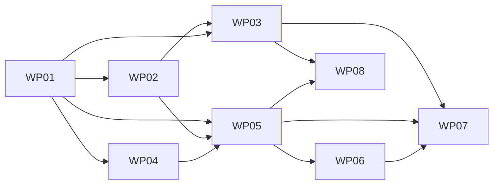

# Tasks: Living schedule and session notes

**Mission**: `living-schedule-01M5N5QA` · **Branch**: `feat/living-schedule` → PR to `main`
**Inputs**: spec.md, plan.md, data-model.md, contracts/, research.md, quickstart.md

Subtask rows are reference rows; completion is recorded with
`spec-kitty agent tasks mark-status <Txxx> --status done --mission living-schedule-01M5N5QA`.

## Subtask Index

| ID | Description | WP | Parallel |
|----|-------------|----|----------|
| T001 | Read/lex directory; writing rules (classes a, c) | WP01 | |
| T002 | Shape validation (b, d, f, g, h, i) | WP01 | |
| T003 | Identity rule and uniqueness (e, f) | WP01 | |
| T004 | Note checks (j, k) and public API | WP01 | |
| T005 | Valid fixture | WP01 | [P] |
| T006 | Must-fail patches and model tests | WP01 | |
| T007 | Rooms data | WP02 | |
| T008 | Day file: slots and grid sessions | WP02 | |
| T009 | Sections | WP02 | |
| T010 | Validate, count, identity checklist | WP02 | |
| T011 | check-schedule.mjs with self-test | WP03 | |
| T012 | Proofreading list and orphan warnings | WP03 | |
| T013 | package.json scripts | WP03 | |
| T014 | CI steps Schedule data, Unit tests | WP03 | |
| T015 | Check and board tests | WP03 | |
| T016 | site.config.mjs | WP04 | [P] |
| T017 | Session note template | WP04 | [P] |
| T018 | links.mjs | WP04 | |
| T019 | Links tests incl. real validator | WP04 | |
| T020 | Prefill evidence page | WP04 | [P] |
| T021 | buildScheduleView | WP05 | |
| T022 | source.ts | WP05 | |
| T023 | Kind layout registration and schedule page | WP05 | |
| T024 | ScheduleLayout and ScheduleList | WP05 | |
| T025 | schedule.css and guard extension | WP05 | |
| T026 | View tests | WP05 | |
| T027 | Build and 375px verification | WP05 | |
| T028 | ScheduleTable and table CSS | WP06 | |
| T029 | DaySwitcher | WP06 | [P] |
| T030 | Two-day fixture data and notes | WP06 | [P] |
| T031 | build-schedule-fixture.mjs | WP06 | |
| T032 | api/schedule.json route | WP07 | |
| T033 | text.mjs and page-views splice | WP07 | |
| T034 | check-schedule-dist.mjs with self-test | WP07 | |
| T035 | Text and dist tests | WP07 | |
| T036 | check:dist and CI fixture job | WP07 | |
| T037 | Timings | WP07 | |
| T038 | Sessions hub | WP08 | [P] |
| T039 | Home hero CTA | WP08 | [P] |
| T040 | Guide rewrite | WP08 | |
| T041 | AGENTS.md and charter gates | WP08 | |
| T042 | ADR 0003 | WP08 | [P] |

## Work Packages

### WP01 – Schedule model and validation core

- **Prompt**: [tasks/WP01-schedule-model-and-validation.md](./tasks/WP01-schedule-model-and-validation.md)
- **Priority**: P1 (slice 1)
- **Dependencies: none.**
- **Summary**: The single validator: writing rules, shape, identity, note checks; text-patch fixtures.
- **Risks**: Overlapping classes; quoting lost in fixtures.

T001 Read/lex directory; writing rules (classes a, c) (WP01)
T002 Shape validation (b, d, f, g, h, i) (WP01)
T003 Identity rule and uniqueness (e, f) (WP01)
T004 Note checks (j, k) and public API (WP01)
T005 Valid fixture (WP01)
T006 Must-fail patches and model tests (WP01)

### WP02 – Friday 23 October board transcription

- **Prompt**: [tasks/WP02-friday-board-transcription.md](./tasks/WP02-friday-board-transcription.md)
- **Priority**: P1 (slice 1)
- **Depends on WP01.**
- **Summary**: 49 sessions, 8 rooms, 10 slots, 2 uncertain, no names.
- **Risks**: Name leakage; transcription notes copied as descriptions.

T007 Rooms data (WP02)
T008 Day file: slots and grid sessions (WP02)
T009 Sections (WP02)
T010 Validate, count, identity checklist (WP02)

### WP03 – Schedule check script and CI wiring

- **Prompt**: [tasks/WP03-checks-and-ci-wiring.md](./tasks/WP03-checks-and-ci-wiring.md)
- **Priority**: P1 (slice 1; FR-020 slice 2; FR-024 slice 3)
- **Depends on WP01, WP02.**
- **Summary**: pnpm check:schedule, pnpm test, named CI steps, proofreading list.
- **Risks**: Summary only in logs; dependency drift.

T011 check-schedule.mjs with self-test (WP03)
T012 Proofreading list and orphan warnings (WP03)
T013 package.json scripts (WP03)
T014 CI steps Schedule data, Unit tests (WP03)
T015 Check and board tests (WP03)

### WP04 – Session note template, note links and prefill

- **Prompt**: [tasks/WP04-note-template-and-links.md](./tasks/WP04-note-template-and-links.md)
- **Priority**: P1 (slice 1; FR-013b slice 3)
- **Depends on WP01.**
- **Summary**: Template, links.mjs, site.config.mjs, prefill validated by the real CLI.
- **Risks**: Undocumented GitHub prefill.

T016 site.config.mjs (WP04)
T017 Session note template (WP04)
T018 links.mjs (WP04)
T019 Links tests incl. real validator (WP04)
T020 Prefill evidence page (WP04)

### WP05 – Schedule page, view model and phone list layout

- **Prompt**: [tasks/WP05-schedule-page-and-list-layout.md](./tasks/WP05-schedule-page-and-list-layout.md)
- **Priority**: P1 (slice 1)
- **Depends on WP01, WP02, WP04.**
- **Summary**: One view model; docs page with kind layout; list layout; no JS.
- **Risks**: Kind type cast; Starlight table CSS; Pagefind.

T021 buildScheduleView (WP05)
T022 source.ts (WP05)
T023 Kind layout registration and schedule page (WP05)
T024 ScheduleLayout and ScheduleList (WP05)
T025 schedule.css and guard extension (WP05)
T026 View tests (WP05)
T027 Build and 375px verification (WP05)

### WP06 – Wide-screen table, day switcher and two-day fixture build

- **Prompt**: [tasks/WP06-table-layout-and-day-switcher.md](./tasks/WP06-table-layout-and-day-switcher.md)
- **Priority**: P2 (slice 2)
- **Depends on WP05.**
- **Summary**: Table semantics, switcher, fixture build with notes.
- **Risks**: Fixture notes leaking into docs/.

T028 ScheduleTable and table CSS (WP06)
T029 DaySwitcher (WP06)
T030 Two-day fixture data and notes (WP06)
T031 build-schedule-fixture.mjs (WP06)

### WP07 – Agent surfaces, parity and post-build checks

- **Prompt**: [tasks/WP07-agent-surfaces-and-dist-checks.md](./tasks/WP07-agent-surfaces-and-dist-checks.md)
- **Priority**: P2 (slice 2; FR-005 dist checks slice 1)
- **Depends on WP03, WP05, WP06.**
- **Summary**: api/schedule.json, text splice, dist checker with self-test, CI fixture job.
- **Risks**: Vacuous parity; Starlight scripts on every page.

T032 api/schedule.json route (WP07)
T033 text.mjs and page-views splice (WP07)
T034 check-schedule-dist.mjs with self-test (WP07)
T035 Text and dist tests (WP07)
T036 check:dist and CI fixture job (WP07)
T037 Timings (WP07)

### WP08 – Sessions hub, home page, guide, rules and ADR

- **Prompt**: [tasks/WP08-hub-home-guide-and-rules.md](./tasks/WP08-hub-home-guide-and-rules.md)
- **Priority**: P1 (slice 1; ADR slice 2)
- **Depends on WP03, WP05.**
- **Summary**: Hub without hand list, schedule CTAs, guide, AGENTS.md, charter, ADR 0003.
- **Risks**: Published page linking a draft.

T038 Sessions hub (WP08)
T039 Home hero CTA (WP08)
T040 Guide rewrite (WP08)
T041 AGENTS.md and charter gates (WP08)
T042 ADR 0003 (WP08)

## Dependency graph

Parallel opportunities: WP02, WP03 and WP04 after WP01 (WP03 waits for WP02's
data for its board test); WP06 and WP08 after WP05.

MVP (slice 1): WP01–WP05 and WP08. Cut order if time runs short: FR-024 (WP03),
FR-013b (WP04), NFR-005 (WP07), FR-020 (WP03), FR-010a (WP06), FR-021b (WP07),
FR-003 (WP06).
